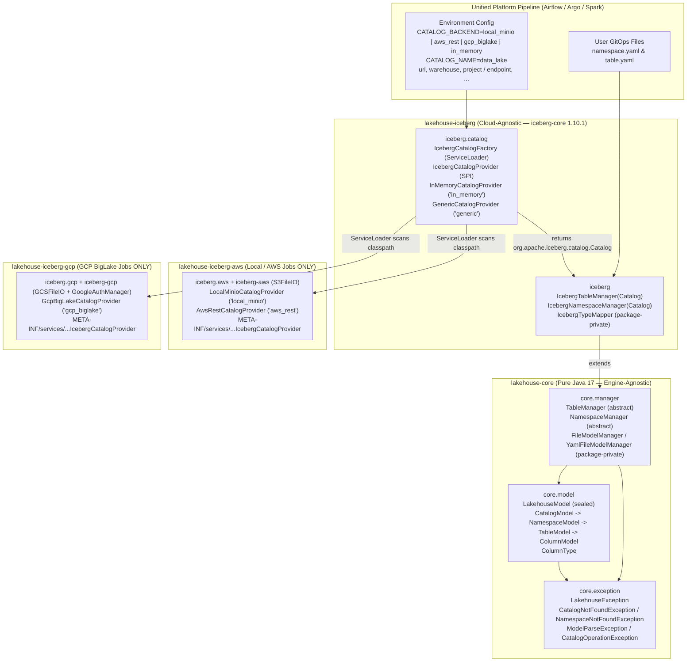
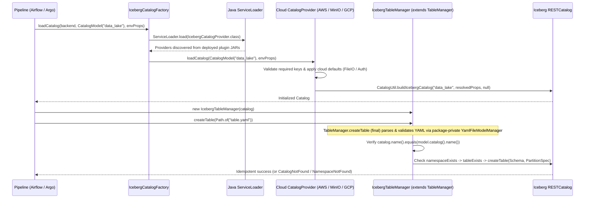

# Lakehouse SDK (`sdk.lakehouse`)

A multi-module **Java 17** SDK for declarative GitOps management of lakehouse namespaces and tables across Apache Iceberg catalogs. Designed for platform pipelines (Airflow, Argo, Spark, CI/CD) so a **single unified pipeline codebase** can deploy identical YAML definitions to local Docker REST + MinIO, AWS Iceberg REST, or Google Cloud BigLake Iceberg REST simply by swapping environment configuration and dropping in the target cloud SPI plugin JAR.

---

## Core Design Principles

- **Acyclic, Self-Validating Domain Models (`lakehouse-core`):** Composable immutable Java 17 `record`s (`CatalogModel` ← `NamespaceModel` ← `TableModel` → `ColumnModel`) with a closed canonical `ColumnType` enum and zero engine or serialization dependencies.
- **Encapsulated Template-Method Managers:** `TableManager` and `NamespaceManager` are `abstract` base classes whose `public final` `Path`-based methods own YAML parsing and validation via package-private `FileModelManager` / `YamlFileModelManager`—preventing calling libraries from bypassing validation or touching parsers directly.
- **Platform-Provisioned Catalogs & Strict Parent Checks:** Catalogs are provisioned externally by platform infrastructure (never via YAML). Managers enforce exact `catalog.name()` identity (`CatalogNotFoundException` on cross-environment mismatch) and never silently auto-create missing catalogs or namespaces (`NamespaceNotFoundException`).
- **Cloud-Isolated `ServiceLoader` SPI Plugins:** `lakehouse-iceberg` has zero AWS or GCP dependencies. Cloud-specific `FileIO` bundles and catalog providers live in thin sibling JARs (`lakehouse-iceberg-aws`, `lakehouse-iceberg-gcp`) discovered at runtime via `java.util.ServiceLoader`, keeping Spark/pipeline shaded fat JARs lean and conflict-free.

---

## Architecture Overview

### Multi-Module & SPI Plugin Architecture



### Runtime Execution Flow (Template Method + SPI)



---

## Module Layout

| Module | Artifact ID | Dependencies | Responsibilities |
| :--- | :--- | :--- | :--- |
| **Root Reactor** | `sdk.lakehouse` (`pom`) | Centralizes `<iceberg.version>` (`1.10.1`), Jackson, JUnit 5, AssertJ | Multi-module build & dependency management |
| **Core Contracts** | `lakehouse-core` | Jackson YAML, Log4j2 *(zero Iceberg/Spark/cloud deps)* | Immutable models (`core.model`), Template-Method managers + package-private YAML file manager (`core.manager`), exception hierarchy (`core.exception`) |
| **Iceberg Adapter** | `lakehouse-iceberg` | `lakehouse-core`, `iceberg-core` *(zero AWS/GCP deps)* | `IcebergTableManager`, `IcebergNamespaceManager`, package-private `IcebergTypeMapper`, `IcebergCatalogProvider` SPI, `IcebergCatalogFactory`, built-in `in_memory` & `generic` providers |
| **AWS / MinIO Plugin** | `lakehouse-iceberg-aws` | `lakehouse-iceberg`, `iceberg-aws`, `iceberg-aws-bundle` | `LocalMinioCatalogProvider` (`local_minio`), `AwsRestCatalogProvider` (`aws_rest`), opt-in Docker REST + MinIO IT |
| **GCP BigLake Plugin** | `lakehouse-iceberg-gcp` | `lakehouse-iceberg`, `iceberg-gcp`, `iceberg-gcp-bundle` | `GcpBigLakeCatalogProvider` (`gcp_biglake` with `GCSFileIO` + native `GoogleAuthManager`), opt-in BigLake REST IT |

---

## Declarative YAML Formats

**Namespace YAML (`namespace.yaml`):**
```yaml
catalog: data_lake
namespace: market_data
```

**Table YAML (`table.yaml`):**
```yaml
catalog: data_lake
namespace: market_data
tableName: transactions
columns:
  - name: date
    type: DATE
    nullable: false
  - name: id
    type: BIGINT
    nullable: false
  - name: amount
    type: DECIMAL
    nullable: true
partitionColumn: date
```

*Supported canonical types:* `STRING`, `INT`, `BIGINT`, `DOUBLE`, `BOOLEAN`, `DATE`, `TIMESTAMP` (Iceberg `timestamptz`), `DECIMAL` (Iceberg `DECIMAL(38, 9)`). Omitted `nullable` defaults to `true`; omitted `partitionColumn` creates an unpartitioned table.

---

## Build, Test & Local Sandbox

### 1. Run All Unit Tests & Strict Javadoc Validation (No Docker / Cloud Creds Needed)
```bash
mvn clean test
mvn test javadoc:javadoc -Ddoclint=all
```

### 2. Run Opt-In Local Docker REST + MinIO Integration Test
Start the local sandbox (`iceberg-rest` on `:8181`, MinIO on `:9000` / `:9001`, Spark Iceberg):
```bash
docker compose up -d
mvn test -pl lakehouse-iceberg-aws -am \
  -Dtest=IcebergRestCatalogIT \
  -Dsurefire.failIfNoSpecifiedTests=false
```

Inspect created namespaces and tables via Spark SQL:
```bash
docker exec -it spark-iceberg spark-sql
```
```sql
SHOW NAMESPACES;
SHOW TABLES IN demo.market_data;
DESCRIBE TABLE EXTENDED demo.market_data.transactions;
```

### 3. Run Opt-In Live GCP BigLake REST Integration Test
Requires active Google Application Default Credentials (`gcloud auth application-default login` or workload identity):
```bash
mvn test -pl lakehouse-iceberg-gcp -am \
  -Dtest=BigLakeRestCatalogIT \
  -Dsurefire.failIfNoSpecifiedTests=false \
  -Dbiglake.warehouse=gs://your-bucket/ \
  -Dbiglake.project=your-gcp-project-id
```

---

## Specifications (Spec-Driven Development)

- [specs/00_project_structure_and_organization.md](specs/00_project_structure_and_organization.md) — Multi-module layout, package roles, visibility, and naming governance.
- [specs/01_lakehouse_core_domain_models.md](specs/01_lakehouse_core_domain_models.md) — Composable immutable domain models, canonical `ColumnType`, and exception hierarchy.
- [specs/02_lakehouse_core_managers_and_yaml.md](specs/02_lakehouse_core_managers_and_yaml.md) — Engine-agnostic Template-Method managers and encapsulated YAML parsing.
- [specs/03_iceberg_core_adapter_and_spi.md](specs/03_iceberg_core_adapter_and_spi.md) — Cloud-agnostic Iceberg adapter, `ServiceLoader` catalog SPI, and built-in providers.
- [specs/04_iceberg_aws_plugin.md](specs/04_iceberg_aws_plugin.md) — Thin `lakehouse-iceberg-aws` SPI plugin (`local_minio`, `aws_rest`) and opt-in Docker IT.
- [specs/05_iceberg_gcp_biglake_plugin.md](specs/05_iceberg_gcp_biglake_plugin.md) — Thin `lakehouse-iceberg-gcp` BigLake REST SPI plugin (`GCSFileIO` + `GoogleAuthManager`) and Iceberg `1.10.1` upgrade.
