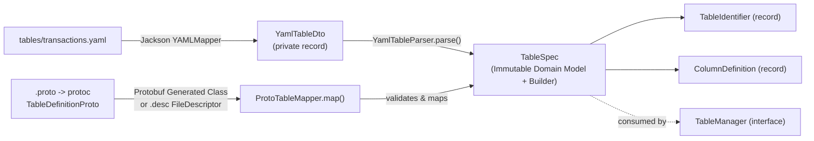

# 01: Ingesting YAML (v1) & Protobuf (v2) into Java Data Classes (`lakehouse-core`)

## Goal Description

Design and implement **Module 1 (`lakehouse-core`)** from your [README.md](../README.md) architecture so the SDK can ingest declarative table definitions from:

1. **v1 — YAML files** (e.g., `tables/transactions.yaml`) via **Jackson YAML** (`jackson-dataformat-yaml`) → `YamlTableParser` → `TableSpec`
2. **v2 — Protobuf definitions** (`TableDefinitionProto`) via **Protobuf Java** (`protobuf-java` + `protoc`) → `ProtoTableMapper` → `TableSpec`

Both ingestion paths converge onto the exact same **immutable, engine-agnostic Java data classes** (`TableIdentifier`, `ColumnDefinition`, `TableSpec`), keeping your domain layer clean and decoupled from both input formats (YAML/Proto) and downstream catalog engines (Iceberg/BigLake).

---

## Architecture & Key Concept: Why Separate "Wire/File Shape" from "Domain Data Class"?



### How YAML → Java Data Class Works (Jackson)
1. **Read bytes/characters** from a `Path`, `File`, `InputStream`, or `String` (e.g., `Files.newInputStream(path)` or classpath resource).
2. **Deserialize with Jackson's `ObjectMapper(new YAMLFactory())`** (or `YAMLMapper.builder().build()`) into an intermediate **private DTO `record`** (e.g., `YamlTableDto`) whose field names match the YAML keys (`snake_case` via `@JsonProperty` or `PropertyNamingStrategies.SNAKE_CASE`).
3. **Validate & convert** the DTO into your immutable domain model (`TableSpec.builder(...)`) so:
   - Your core `TableSpec` stays free of Jackson annotations (`@JsonProperty`, `@JsonCreator`).
   - Validation rules (non-blank table name, non-empty columns, duplicate column checks, immutable `List.copyOf` / `Map.copyOf`) live in one place.

### How Protobuf → Java Data Class Works (2 Patterns)
There are two ways to ingest a `.proto` file in Java — choosing the right one depends on how your `.proto` is structured:

| Pattern | How It Works | Best For |
| :--- | :--- | :--- |
| **Pattern A: Data Contract Proto (Recommended for v2 gRPC / API)** | Define a `message TableDefinitionProto` whose fields hold `namespace`, `table_name`, `repeated ColumnProto columns`, `repeated string partition_by`, `map<string, string> properties`. Compile with `protoc` into a Java class. Receive binary/gRPC/TextFormat/JSON payloads and map getters directly in `ProtoTableMapper.toTableSpec(TableDefinitionProto)`. | Receiving table creation requests over gRPC, Kafka, or reading `.pb` / `.textproto` files. Matches `TableDefinitionProto (v2 - Future gRPC / Network Contract)` in your README! |
| **Pattern B: Schema-as-Proto (Message Reflection)** | Users write a domain message (e.g., `message Transaction { string tx_id = 1; }`) and you inspect `Descriptors.Descriptor` (from `.getDescriptor()` or a `.desc` `FileDescriptorSet`) to turn Protobuf fields themselves into `ColumnDefinition`s. | Reusing existing business event `.proto` schemas directly as Iceberg table schemas. |

> [!IMPORTANT]
> Your [README.md](../README.md) labels `TableDefinitionProto` as **(v2 - Future gRPC / Network Contract)**, which aligns cleanly with **Pattern A** (a `TableDefinitionProto` message mapped into `TableSpec` by `ProtoTableMapper`).

---

## User Review Required & Open Questions

> [!IMPORTANT]
> Please confirm your preferences on these 4 design decisions before writing any code:

1. **Scope for this pass (v1 only vs. v1 + v2)**:
   - **Option 1 (Recommended)**: Implement all 4 core models/contracts (`TableIdentifier`, `ColumnDefinition`, `TableSpec`, `TableManager`) + full **v1 `YamlTableParser`** with sample `tables/transactions.yaml` + unit tests, AND stub/skeleton `ProtoTableMapper` for v2 (keeping `lakehouse-core` zero-protobuf until v2).
   - **Option 2**: Implement **both** v1 (`YamlTableParser`) and v2 (`ProtoTableMapper` + `table_definition.proto` compiled via Maven `protobuf-maven-plugin`) right now.
2. **Protobuf Pattern (if implementing v2 now or designing its signature)**:
   - **Pattern A**: `TableDefinitionProto` message (fields: `namespace`, `name`, `columns`, `partitions`, `properties`) — matches your README's *"gRPC / Network Contract"* note.
   - **Pattern B**: Inspecting arbitrary Protobuf `Descriptors.Descriptor` fields as table columns.
3. **YAML Schema Shape**: Does the proposed YAML format below match how you envision `tables/transactions.yaml`?
   ```yaml
   namespace: fintech
   name: transactions
   columns:
     - name: tx_id
       type: STRING
       nullable: false
       doc: "Unique transaction identifier"
     - name: amount
       type: DECIMAL(10, 2)
       nullable: false
     - name: created_at
       type: TIMESTAMP
       nullable: false
   partition_by:
     - day(created_at)
   properties:
     format-version: "2"
     write.format.default: parquet
   ```
4. **Clean up `lakehouse-core/pom.xml`**: Currently [lakehouse-core/pom.xml](../lakehouse-core/pom.xml) still declares `spark-sql_2.12`. Since Module 1 is now **Pure Java - Engine Agnostic**, should we remove `spark-sql_2.12` from `lakehouse-core/pom.xml` when adding `jackson-dataformat-yaml`?

---

## Proposed Changes

### 1. Maven Dependencies (`lakehouse-core`)

#### [MODIFY] [lakehouse-core/pom.xml](../lakehouse-core/pom.xml)
- Remove unused `spark-sql_2.12` dependency (keeping `lakehouse-core` pure Java).
- Add Jackson YAML support:
  ```xml
  <dependency>
    <groupId>com.fasterxml.jackson.dataformat</groupId>
    <artifactId>jackson-dataformat-yaml</artifactId>
    <version>2.18.2</version>
  </dependency>
  ```
- *(Only if Option 2 is chosen)* Add `com.google.protobuf:protobuf-java` + `protobuf-maven-plugin` + `os-maven-plugin` to compile `table_definition.proto`.

---

### 2. Immutable Domain Models (`lakehouse-core`)

#### [MODIFY] [TableIdentifier.java](../lakehouse-core/src/main/java/x/ruiz/playground/data/engineering/lakehouse/core/TableIdentifier.java)
Java `record` with compact constructor validation:
```java
package x.ruiz.playground.data.engineering.lakehouse.core;

public record TableIdentifier(String namespace, String name) {
    public TableIdentifier {
        if (namespace == null || namespace.isBlank()) {
            throw new IllegalArgumentException("namespace must not be blank");
        }
        if (name == null || name.isBlank()) {
            throw new IllegalArgumentException("table name must not be blank");
        }
    }

    public String fullyQualifiedName() {
        return namespace + "." + name;
    }
}
```

#### [MODIFY] [ColumnDefinition.java](../lakehouse-core/src/main/java/x/ruiz/playground/data/engineering/lakehouse/core/ColumnDefinition.java)
Java `record` representing a single column's engine-agnostic schema metadata:
```java
package x.ruiz.playground.data.engineering.lakehouse.core;

public record ColumnDefinition(String name, String type, boolean nullable, String doc) {
    public ColumnDefinition {
        if (name == null || name.isBlank()) {
            throw new IllegalArgumentException("column name must not be blank");
        }
        if (type == null || type.isBlank()) {
            throw new IllegalArgumentException("column type must not be blank");
        }
    }

    public ColumnDefinition(String name, String type, boolean nullable) {
        this(name, type, nullable, null);
    }
}
```

#### [MODIFY] [TableSpec.java](../lakehouse-core/src/main/java/x/ruiz/playground/data/engineering/lakehouse/core/TableSpec.java)
Immutable class backed by a fluent `Builder`:
- Fields: `TableIdentifier identifier`, `List<ColumnDefinition> columns`, `List<String> partitionBy`, `Map<String, String> properties`.
- Enforces non-null `identifier`, non-empty `columns`, no duplicate column names, and defensive immutability via `List.copyOf(...)` / `Map.copyOf(...)`.

---

### 3. Core Contract (`lakehouse-core`)

#### [MODIFY] [TableManager.java](../lakehouse-core/src/main/java/x/ruiz/playground/data/engineering/lakehouse/core/TableManager.java)
Exact interface contract from [README.md](../README.md):
```java
package x.ruiz.playground.data.engineering.lakehouse.core;

public interface TableManager {
    void createTable(TableSpec spec);
    void dropTable(TableIdentifier identifier);
    boolean tableExists(TableIdentifier identifier);
}
```

---

### 4. Parsers / Mappers (`lakehouse-core`)

#### [MODIFY] [YamlTableParser.java](../lakehouse-core/src/main/java/x/ruiz/playground/data/engineering/lakehouse/core/YamlTableParser.java)
Ingests YAML from a `Path`, `InputStream`, or raw `String` using Jackson's `ObjectMapper(new YAMLFactory())`:
```java
public class YamlTableParser {
    private final ObjectMapper yamlMapper;

    public YamlTableParser() {
        this.yamlMapper = new ObjectMapper(new YAMLFactory())
                .setPropertyNamingStrategy(PropertyNamingStrategies.SNAKE_CASE);
    }

    public TableSpec parse(Path yamlFile) throws IOException {
        try (InputStream in = Files.newInputStream(yamlFile)) {
            return parse(in);
        }
    }

    public TableSpec parse(InputStream inputStream) throws IOException {
        YamlTableDto dto = yamlMapper.readValue(inputStream, YamlTableDto.class);
        return toTableSpec(dto);
    }

    public TableSpec parseString(String yamlContent) throws IOException {
        YamlTableDto dto = yamlMapper.readValue(yamlContent, YamlTableDto.class);
        return toTableSpec(dto);
    }

    // Private Jackson DTOs keep Jackson annotations out of TableSpec / ColumnDefinition
    private record YamlTableDto(
            String namespace,
            String name,
            List<YamlColumnDto> columns,
            List<String> partitionBy,
            Map<String, String> properties) {}

    private record YamlColumnDto(
            String name,
            String type,
            Boolean nullable,
            String doc) {}
}
```
Notice how `Boolean nullable` (boxed) defaults cleanly to `true` when omitted in YAML, while `nullable: false` maps to a required column.

#### [MODIFY] [ProtoTableMapper.java](../lakehouse-core/src/main/java/x/ruiz/playground/data/engineering/lakehouse/core/ProtoTableMapper.java)
- **If Option 1 (v1 focus)**: Documented placeholder ready for v2 gRPC / `TableDefinitionProto` mapping without pulling `protobuf-java` into `lakehouse-core` yet.
- **If Option 2 (v1 + v2 now)**: Compiles `src/main/proto/table_definition.proto` (`TableDefinitionProto` + `ColumnDefinitionProto`) and implements:
  - `TableSpec toTableSpec(TableDefinitionProto proto)` (from in-memory gRPC/Protobuf object)
  - `TableSpec parseBinary(Path protoBinaryFile)` / `parseBinary(InputStream)` (`TableDefinitionProto.parseFrom(in)`)
  - `TableSpec parseTextFormat(String textProto)` (`TextFormat.parse(...)` — great for human-readable `.textproto` files)

---

### 5. Sample Config & Unit Tests

#### [NEW] `lakehouse-core/src/test/resources/tables/transactions.yaml`
Sample declarative YAML matching the README's `tables/transactions.yaml` input box.

#### [NEW] `lakehouse-core/src/test/java/x/ruiz/playground/data/engineering/lakehouse/core/YamlTableParserTest.java`
Tests:
- Parsing `tables/transactions.yaml` from classpath & `Path` into `TableSpec`
- Verifying `TableIdentifier`, `ColumnDefinition`s (including default `nullable = true` when omitted), `partitionBy`, and `properties`
- Rejecting invalid YAML (missing table name, missing columns, duplicate column names, unknown YAML fields)

#### [NEW] *(If Option 2)* `lakehouse-core/src/test/java/x/ruiz/playground/data/engineering/lakehouse/core/ProtoTableMapperTest.java`
Tests mapping `TableDefinitionProto` (builder + binary round-trip) into an identical `TableSpec` and asserting equality with the YAML-parsed `TableSpec`.

---

## Verification Plan

### Automated Tests
Run from `maven_projects/sdk_lakehouse`:
```bash
mvn clean test
```
Verify:
- `lakehouse-core` compiles cleanly under Java 17 with zero Spark dependency.
- All unit tests pass for `TableIdentifier`, `ColumnDefinition`, `TableSpec`, `YamlTableParser` (and `ProtoTableMapper` if Option 2 is selected).

### Manual Verification
- Inspect `transactions.yaml` alongside the parsed `TableSpec` test assertions to confirm the YAML format feels intuitive for your GitOps workflow.
