# Spec 00: Repository Folder Structure & Class Organization

| Field | Value |
| :--- | :--- |
| **Status** | `Approved` |
| **Owner** | Xavier Ruiz |
| **Component** | `sdk.lakehouse` (Multi-Module Maven Reactor) |
| **Stack** | Java 17 · Maven Multi-Module · JUnit 5 · ServiceLoader SPI |
| **Archetype / Tier** | Software Library Contract (Architecture & Structural Governance) · Mini-Spec (`12 REQs`, `8 TCs`) |
| **Downstream** | [Spec 01](./01_lakehouse_core_contracts.md), [Spec 02](./02_iceberg_catalog_adapter.md), [Spec 03](./03_iceberg_gcp_biglake_plugin.md) |

---

## 1. Overview & Design

### TL;DR
`sdk.lakehouse` is evolving from a single contract module (`lakehouse-core`) into a multi-engine, cloud-isolated lakehouse SDK (`lakehouse-iceberg`, thin cloud SPI plugins, and future engines or Protobuf/gRPC ingestion). This foundational spec locks in the canonical Maven reactor layout, role-based subpackages inside `lakehouse-core`, package-private parser encapsulation, and flat-by-default engine adapter conventions. Downstream engine and cloud-plugin specs build directly on these boundaries with zero dependency leakage.

### Architecture

```mermaid
%%{init: {"theme": "base", "themeCSS": "svg { background-color: #09090B !important; border-radius: 8px; }", "themeVariables": {"darkMode": true, "background": "#09090B", "mainBkg": "#18181B", "textColor": "#F4F4F5", "primaryColor": "#18181B", "primaryTextColor": "#F4F4F5", "primaryBorderColor": "#7C3AED", "lineColor": "#A855F7", "secondaryColor": "#16141F", "tertiaryColor": "#0F0F14", "edgeLabelBackground": "#18181B", "clusterBkg": "#0F0F14", "clusterBorder": "#52525B", "titleColor": "#D8B4FE", "fontFamily": "Inter, ui-sans-serif, system-ui, -apple-system, sans-serif", "fontSize": "13px"}, "flowchart": {"curve": "basis", "nodeSpacing": 42, "rankSpacing": 56, "padding": 14}}}%%
flowchart TB
    subgraph Reactor["1. sdk.lakehouse Maven Reactor (Root pom.xml · Java 17)"]
        Specs[("Root Docs\nspecs/NN_*.md\nplans/NN_*.md")]

        subgraph CoreMod["2. lakehouse-core (Pure Java 17 — Zero Engine/Cloud Deps)"]
            Mgr["...core.manager\nAbstract Managers · public\nFileModelManager · pkg-private"]
            Mod["...core.model\nSealed LakehouseModel\nImmutable Records · ColumnType"]
            Exc["...core.exception\nLakehouseException\nUnchecked Hierarchy"]
        end

        subgraph EngineMod["3. lakehouse-<engine> (Cloud-Agnostic Adapter)"]
            IceRoot["...lakehouse.iceberg\nFlat Managers · public\nMappers · pkg-private"]
            IceCat["...iceberg.catalog\nSPI Subsystem · 3+ classes\nServiceLoader Factory"]
        end

        subgraph Plugins["4. lakehouse-<engine>-<cloud> (Isolated Thin SPI Plugins)"]
            AwsPlug["lakehouse-iceberg-aws\n...iceberg.aws\nMETA-INF/services · Zero GCP"]
            GcpPlug["lakehouse-iceberg-gcp\n...iceberg.gcp\nMETA-INF/services · Zero AWS"]
        end
    end

    Mgr ==>|"depends on"| Mod
    Mgr ==>|"throws"| Exc
    Mod <-->|"validates / carries"| Exc
    IceRoot ==>|"extends managers"| Mgr
    IceRoot -->|"uses models & errors"| Mod
    IceCat -.->|"discovered via SPI"| IceRoot
    AwsPlug -.->|"implements SPI"| IceCat
    GcpPlug -.->|"implements SPI"| IceCat

    classDef core fill:#2E1065,stroke:#A855F7,stroke-width:2px,color:#F5F3FF
    classDef service fill:#18181B,stroke:#7C3AED,stroke-width:1.5px,color:#F4F4F5
    classDef store fill:#09090B,stroke:#C084FC,stroke-width:1.5px,color:#EDE9FE
    classDef async fill:#1E1B2E,stroke:#6B7280,stroke-width:1.25px,stroke-dasharray:4 3,color:#D4D4D8

    class Mgr,IceCat core
    class Mod,Exc,IceRoot service
    class Specs store
    class AwsPlug,GcpPlug async

    style Reactor fill:#0F0F14,stroke:#52525B,stroke-width:1.5px,color:#D8B4FE
    style CoreMod fill:#16141F,stroke:#6D28D9,stroke-width:1.25px,stroke-dasharray:4 3,color:#C4B5FD
    style EngineMod fill:#16141F,stroke:#6D28D9,stroke-width:1.25px,stroke-dasharray:4 3,color:#C4B5FD
    style Plugins fill:#16141F,stroke:#6D28D9,stroke-width:1.25px,stroke-dasharray:4 3,color:#C4B5FD
```



### Key Design Decisions
- **Three-tier module isolation:** Splitting contracts (`lakehouse-core`), cloud-agnostic engines (`lakehouse-<engine>`), and thin cloud SPI plugins (`lakehouse-<engine>-<cloud>`) keeps runtime fat JARs lean and prevents cross-cloud SDK conflicts.
- **Role-based core subpackages:** Splitting `lakehouse-core` into `.model`, `.manager`, and `.exception` satisfies Java 17 unnamed-module `sealed` co-location rules while keeping serialization DTOs and parsers strictly encapsulated.
- **Compile-time parser encapsulation:** Keeping `FileModelManager` and format parsers package-private inside `...core.manager` prevents external callers or engine adapters from coupling to Jackson or Protobuf internals.
- **Flat-by-default engine packages:** Engine modules start flat under `...lakehouse.<engine>` and split into subpackages (such as `.catalog` or `.auth`) only once a cohesive subsystem reaches 3+ related classes or needs an explicit boundary.

### Done Looks Like
- Every module, folder, package, and test directory across `sdk.lakehouse` conforms to Section 4 with zero orphaned classes in root `...lakehouse.core`.
- `lakehouse-core` compiles and passes all tests with zero engine dependencies (`org.apache.iceberg.*`, `org.apache.spark.*`) and zero serialization leakage into domain models or exceptions.
- Full-reactor `mvn clean test` passes on Java 17 and acceptance cases `TC-001` through `TC-008` are verified.

---

## 2. Scope

### In Scope
- Define the canonical multi-module Maven reactor layout across core contracts, engine adapters, and thin cloud SPI plugins.
- Standardize placement of repository specs (`specs/NN_<snake_case>.md`) and sequential implementation plans (`plans/NN_<snake_case>.md`).
- Organize `lakehouse-core` into `.model`, `.manager`, and `.exception` with package-private parser encapsulation and strict intra-core layering.
- Establish default flat package layout and subsystem-growth criteria for engine adapter modules (`lakehouse-<engine>`).
- Standardize Java class visibility, naming conventions, Protobuf/resource placement, and mirrored test-package rules.
- Mandate synchronous updates to affected module specs (starting with `01_lakehouse_core_contracts.md`) whenever packages are restructured.

### Out of Scope (Non-Goals)
- **No JPMS (`module-info.java`) modularization:** Artifacts remain standard Java 17 classpath JARs.
- **No new engine modules or `lakehouse-iceberg` features:** Scaffolding `lakehouse-delta`, `lakehouse-biglake`, or Iceberg managers belongs to follow-up specs.
- **No behavioral contract changes:** Domain validation, idempotency, exception semantics, and parser behavior remain owned by module feature specs (such as Spec 01).
- **No automated architecture-lint plugins yet:** Adding ArchUnit, Checkstyle, or Spotless to Maven is deferred to a future quality-gates spec.
- **No changes to local dev infrastructure:** `docker-compose.yaml`, `Makefile`, `notebooks/`, and `warehouse/` remain untouched.

---

## 3. Functional Requirements

Exact folder layouts, module matrices, and naming conventions live once in **Section 4**.

### Repository & Module Structure

| ID | What | Why | How |
| :--- | :--- | :--- | :--- |
| `REQ-01` | Three-tier Maven reactor layout | Isolates core contracts from engines and prevents cross-cloud SDK bloat in runtime JARs | One pure `lakehouse-core`, cloud-agnostic `lakehouse-<engine>` adapters, and `ServiceLoader`-discovered `lakehouse-<engine>-<cloud>` plugins (§4.2) |
| `REQ-02` | Centralized specs and plans placement | Gives engineers a single predictable index for architecture specs, feature specs, and plans | All specs live in root `specs/NN_<snake_case>.md` (`00_`, `01_`, `02_`, ...); plans live in root `plans/NN_<snake_case>.md` |

### `lakehouse-core` Package Organization

| ID | What | Why | How |
| :--- | :--- | :--- | :--- |
| `REQ-03` | Role-based subpackages in `lakehouse-core` | Eliminates flat-package clutter and enforces clear architectural boundaries | Organize all production classes under `.model`, `.manager`, and `.exception` beneath `...lakehouse.core`; zero classes in root `...lakehouse.core` |
| `REQ-04` | Co-located sealed domain model hierarchy | Satisfies Java 17 unnamed-module `sealed` compilation rules and keeps models cohesive | Place `LakehouseModel`, its permitted subtypes, `ColumnModel`, and `ColumnType` in `...lakehouse.core.model` (§4.3) |
| `REQ-05` | Abstract Template-Method managers & internal parsers | Enforces consistent parse-validate-execute lifecycles while keeping engine code out of core | Place `public abstract` `NamespaceManager` and `TableManager` alongside package-private file parsers in `...lakehouse.core.manager` |
| `REQ-06` | Strict serialization encapsulation | Prevents Jackson or Protobuf annotations and DTOs from leaking into public domain contracts | Keep parsers, DTOs, and serialization APIs package-private or `private` inside `...lakehouse.core.manager`; forbid them in `.model` and `.exception` |
| `REQ-07` | Centralized unchecked exception package | Gives callers a single predictable namespace for all domain, parse, and catalog errors | Place `LakehouseException` and all domain, parsing, not-found, and operation subclasses in `...lakehouse.core.exception` |
| `REQ-08` | Strict intra-core dependency layering | Prevents cyclic dependencies between domain contracts and manager/parser orchestration | `.model` and `.exception` form the foundation layer (never importing `.manager`); `.manager` imports only `.model`, `.exception`, and internal parser libs |

### Engine Modules, Visibility, Naming & Tests

| ID | What | Why | How |
| :--- | :--- | :--- | :--- |
| `REQ-09` | Flat-first engine adapter layout | Avoids premature over-packaging while allowing clean extraction as subsystems grow | Keep engine classes flat under `...lakehouse.<engine>` by default; introduce a subpackage (e.g., `.catalog`, `.auth`) only at 3+ related classes or an explicit boundary |
| `REQ-10` | Minimal public API surface | Prevents external callers from coupling to internal mappers, parsers, or DTOs | Default internal parsers, mappers, and DTOs to package-private or `private` nested types; make only deliberate SDK entry points `public` |
| `REQ-11` | Uniform resources, proto & test mirroring | Enables direct unit testing of package-private helpers without widening production visibility | Place `.proto` under `lakehouse-core/src/main/proto/`, configs in `src/main/resources/`, fixtures in `src/test/resources/`, and mirror production packages for `*Test` (`*IT` for integration) |
| `REQ-12` | Synchronous spec updates on refactor | Prevents documentation drift between specs and actual Java package paths | Update affected specs (starting with `01_lakehouse_core_contracts.md`) in the same change whenever packages move |

---

## 4. Contract & Blueprint

### 4.1 Repository & Package Layout

```text
sdk_lakehouse/
├── pom.xml                                  # Parent reactor (dependencyManagement, Java 17)
├── Makefile
├── docker-compose.yaml                      # Local Iceberg REST + MinIO + Spark sandbox
├── README.md
├── plans/
│   └── 01_<plan_name>.md                    # Sequential implementation plans
├── specs/
│   ├── 00_project_structure_and_organization.md  # Cross-cutting architecture spec
│   ├── 01_lakehouse_core_contracts.md            # Core module feature spec
│   ├── 02_iceberg_catalog_adapter.md             # Iceberg adapter + AWS SPI plugin spec
│   └── 03_iceberg_gcp_biglake_plugin.md          # GCP BigLake SPI plugin + Iceberg 1.10.1 spec
├── lakehouse-core/                          # Pure Java 17 engine-agnostic contracts
│   ├── pom.xml
│   └── src/
│       ├── main/
│       │   ├── java/x/ruiz/playground/data/engineering/lakehouse/core/
│       │   │   ├── model/                   # Immutable domain models & canonical ColumnType
│       │   │   ├── manager/                 # Abstract managers + package-private parsers
│       │   │   └── exception/               # LakehouseException hierarchy
│       │   ├── proto/                       # .proto wire/file schemas
│       │   └── resources/                   # log4j2.xml and runtime config
│       └── test/
│           ├── java/x/ruiz/playground/data/engineering/lakehouse/core/
│           │   ├── model/                   # Model & type unit tests
│           │   └── manager/                 # Manager template, parser & exception unit tests
│           └── resources/                   # Fixtures (table.yaml, namespace.yaml, table.textproto)
├── lakehouse-iceberg/                       # Cloud-agnostic Apache Iceberg adapter module
│   ├── pom.xml
│   └── src/
│       ├── main/
│       │   ├── java/x/ruiz/playground/data/engineering/lakehouse/iceberg/
│       │   │   ├── ...                      # Flat managers & package-private mappers
│       │   │   └── catalog/                 # Catalog SPI & built-in providers (3+ classes)
│       │   └── resources/META-INF/services/ # ServiceLoader provider registrations
│       └── test/
│           ├── java/x/ruiz/playground/data/engineering/lakehouse/iceberg/
│           └── resources/
├── lakehouse-iceberg-aws/                   # Thin AWS / MinIO SPI plugin module (zero GCP deps)
│   ├── pom.xml
│   └── src/
│       ├── main/
│       │   ├── java/x/ruiz/playground/data/engineering/lakehouse/iceberg/aws/
│       │   └── resources/META-INF/services/ # AWS / MinIO ServiceLoader registrations
│       └── test/
│           ├── java/x/ruiz/playground/data/engineering/lakehouse/iceberg/aws/
│           └── resources/
└── lakehouse-iceberg-gcp/                   # Thin GCP BigLake SPI plugin module (zero AWS deps)
    ├── pom.xml
    └── src/
        ├── main/
        │   ├── java/x/ruiz/playground/data/engineering/lakehouse/iceberg/gcp/
        │   └── resources/META-INF/services/ # GCP BigLake ServiceLoader registrations
        └── test/
            ├── java/x/ruiz/playground/data/engineering/lakehouse/iceberg/gcp/
            └── resources/
```

### 4.2 Module Inventory & Dependency Rules

| Module (`Artifact ID`) | Responsibility | Allowed Internal Deps | Forbidden Dependencies |
| :--- | :--- | :--- | :--- |
| Root (`sdk.lakehouse`, `pom`) | Centralizes `dependencyManagement`, `pluginManagement`, and Java 17 release config | Declares child modules only | N/A (`pom` packaging) |
| Core (`lakehouse-core`, `jar`) | Immutable domain models, Template-Method managers, package-private parsers, exceptions | None (leaf module) | `lakehouse-*` engine modules, Iceberg, Spark, AWS/GCP/Azure SDKs |
| Iceberg (`lakehouse-iceberg`, `jar`) | Cloud-agnostic Iceberg managers, type/partition mapping, `IcebergCatalogProvider` SPI (`in_memory`, `generic`) | `lakehouse-core` | Cloud SDKs (`iceberg-aws`, `iceberg-gcp`), sibling engine modules |
| Cloud Plugins (`lakehouse-iceberg-<cloud>`, `jar`) | Thin SPI plugins (`lakehouse-iceberg-aws`, `lakehouse-iceberg-gcp`) bundling one cloud's `FileIO` and providers | `lakehouse-iceberg` (transitively `lakehouse-core`) | Sibling cloud plugins (AWS plugin never depends on GCP plugin or vice versa) |
| Future Engines (`lakehouse-<engine>`, `jar`) | Implements `lakehouse-core` managers for another table format or catalog engine | `lakehouse-core` | Sibling engine modules (adapters never cross-depend) |

### 4.3 `lakehouse-core` Package Boundaries

Base package: `x.ruiz.playground.data.engineering.lakehouse.core`.

| Package | Role & Contents | Allowed Internal Imports | Forbidden Imports |
| :--- | :--- | :--- | :--- |
| `...core.model` | Immutable domain models (`LakehouseModel`, `CatalogModel`, `NamespaceModel`, `TableModel`, `ColumnModel`) and `ColumnType` | `...core.exception` (validation errors) | `...core.manager`, Jackson, Protobuf, engine libs |
| `...core.manager` | Public `NamespaceManager` and `TableManager`; package-private `FileModelManager`, `YamlFileModelManager` (future `ProtoFileModelManager`) | `...core.model`, `...core.exception` | Engine libs (`org.apache.iceberg.*`, `org.apache.spark.*`) |
| `...core.exception` | `LakehouseException`, `Invalid*ModelException`, `ModelParseException`, `*NotFoundException`, `CatalogOperationException` | `...core.model` (for `*NotFoundException` metadata) | `...core.manager`, Jackson, Protobuf, engine libs |

### 4.4 Engine Module Package Strategy

Base package: `x.ruiz.playground.data.engineering.lakehouse.<engine>`.

| Level | Package Pattern | Trigger Criteria | Visibility Guidance |
| :--- | :--- | :--- | :--- |
| Default (Flat) | `...lakehouse.<engine>` | Standard starting layout for managers, mappers, and entry points (e.g., `IcebergTableManager`, `IcebergNamespaceManager`, `IcebergTypeMapper`) | Public managers & factories; package-private mappers so same-package unit tests cover them directly |
| Subsystem Split | `...lakehouse.<engine>.<subsystem>` | Only when a cohesive subsystem reaches 3+ related classes or owns an independent boundary (e.g., `.catalog`, `.auth`) | Expose only the subsystem's facade/SPI/factory as `public`; keep internal helpers package-private |

### 4.5 Naming & Visibility Conventions

| Category | Pattern | Modifier / Kind | Example |
| :--- | :--- | :--- | :--- |
| Domain models | `*Model` | `public record` (or `public sealed interface` root) | `LakehouseModel`, `CatalogModel`, `NamespaceModel`, `TableModel`, `ColumnModel` |
| Canonical enums | Domain noun | `public enum` | `ColumnType` |
| Manager base classes | `*Manager` | `public abstract class` (`public final` template + `protected abstract` `do*`) | `NamespaceManager`, `TableManager` |
| Engine managers | `<Engine>*Manager` | `public class` or `public final class` extending `*Manager` | `IcebergTableManager`, `IcebergNamespaceManager` |
| Internal parser contract | `FileModelManager` | Package-private `interface` in `...core.manager` | `FileModelManager` |
| Internal format parsers | `<Format>FileModelManager` | Package-private `final class` in `...core.manager` | `YamlFileModelManager`, `ProtoFileModelManager` |
| Internal mappers / DTOs | `<Engine>*Mapper`, `<Format>*Dto` | Package-private `final class` or `private record` | `IcebergTypeMapper`, `YamlTableDto` |
| Exceptions | `*Exception` | `public class extends LakehouseException` | `CatalogNotFoundException`, `ModelParseException` |
| Unit / Integration tests | `*Test` / `*IT` | Package-private JUnit 5 class in mirrored package | `TableModelTest`, `YamlFileModelManagerTest`, `IcebergTableManagerIT` |

---

## 5. Invariants & Failure Modes

### Key Invariants
- **Engine independence of `lakehouse-core`:** Zero references to Iceberg, Spark, or cloud storage SDKs exist in `lakehouse-core/pom.xml` or `lakehouse-core/src/`.
- **Sealed hierarchy integrity:** Every `permits` member of `LakehouseModel` lives in `...core.model`; adding a subtype outside that package is rejected by Java 17 compilation.
- **Zero serialization leakage:** Jackson (`@Json*`, `ObjectMapper`, `YAMLMapper`) and future Protobuf types appear exclusively inside package-private parser classes in `...core.manager`—never in `.model`, `.exception`, or `public`/`protected` manager signatures.
- **Compile-time parser encapsulation:** `FileModelManager` and `YamlFileModelManager` stay package-private inside `...core.manager`, blocking external libraries and engine modules from importing YAML parsers directly.
- **Accurate spec synchronization:** Architecture and feature specs stay aligned with actual Java packages and module directories in every refactor.
- **Mirrored test packages:** Unit tests reside in the exact package of the production class under test so package-private helpers stay encapsulated yet directly testable.

### Failure Modes

| Condition | Expected Behavior | Guarantee |
| :--- | :--- | :--- |
| `LakehouseModel` subtype placed outside `...core.model` | Java 17 compile error (sealed class package violation) | Fails at compile time; move subtype into `...core.model` |
| Production class placed directly in root `...lakehouse.core` | Directory audit failure (`TC-002`) | Relocate into `.model`, `.manager`, or `.exception` |
| Serialization annotation or `YAMLMapper` added to `.model` or `.exception` | Code review / grep audit failure (`TC-005`) | Confine serialization to private DTOs inside `...core.manager` parsers |
| `FileModelManager` or `YamlFileModelManager` declared `public` or leaked in public/protected signature | Visibility audit failure (`TC-005`) | Keep parsers package-private; expose only `Path`-based template methods |
| Engine dependency added to `lakehouse-core/pom.xml` | POM audit failure (`TC-004`) | Move dependency into target `lakehouse-<engine>/pom.xml` |
| Downstream module (`lakehouse-iceberg`) has stale imports after package refactor | Maven reactor compile failure (`TC-007`, `TC-008`) | Update downstream imports and pass full-reactor `mvn clean test` |
| Dependent spec (`01_lakehouse_core_contracts.md`) documents stale package paths | Spec review drift failure (`TC-007`) | Update affected spec package tables in the same change |

---

## 6. Acceptance & Verification (`TC-*`)

| Case | Scenario | Pass Condition |
| :--- | :--- | :--- |
| `TC-001` (`REQ-02`, `REQ-12`) | Spec & plan directory hierarchy | Root `specs/` contains `00_project_structure_and_organization.md` and sequential feature specs (`01_lakehouse_core_contracts.md`, etc.), and root `plans/` houses sequential implementation plans. |
| `TC-002` (`REQ-03`) | Zero root-package stragglers in `lakehouse-core` | Listing `.java` files under `lakehouse-core/src/main/java` shows zero files directly in `...lakehouse.core`; every production type lives in `.model`, `.manager`, or `.exception`. |
| `TC-003` (`REQ-04`) | Sealed hierarchy co-location | `LakehouseModel`, `CatalogModel`, `NamespaceModel`, `TableModel`, `ColumnModel`, and `ColumnType` all reside in `...lakehouse.core.model` and compile cleanly on Java 17. |
| `TC-004` (`REQ-01`, `REQ-08`) | Package & module dependency hygiene | `lakehouse-core/pom.xml` and sources contain zero Iceberg/Spark dependencies; `...core.model` and `...core.exception` never import `...core.manager`. |
| `TC-005` (`REQ-05`–`07`, `REQ-10`) | Encapsulation & serialization isolation | `FileModelManager` and `YamlFileModelManager` (`final` with private DTO records) are package-private in `...core.manager`; zero Jackson imports or `@Json*` annotations exist in `.model`, `.exception`, `TableManager`, or `NamespaceManager`. |
| `TC-006` (`REQ-11`) | Mirrored test packages | Every `*Test.java` class under `lakehouse-core/src/test/java` resides in the exact subpackage (`.model` or `.manager`) matching its production subject. |
| `TC-007` (`REQ-09`, `REQ-12`) | Downstream & Spec 01 synchronization | `lakehouse-iceberg` compiles cleanly against the `...core.*` subpackages, and `01_lakehouse_core_contracts.md` documents the exact updated subpackage paths. |
| `TC-008` (`REQ-01`, `REQ-11`) | Full multi-module reactor verification | Running `mvn clean test` at repository root compiles all modules on Java 17 and passes all unit tests with 0 failures and 0 errors. |
