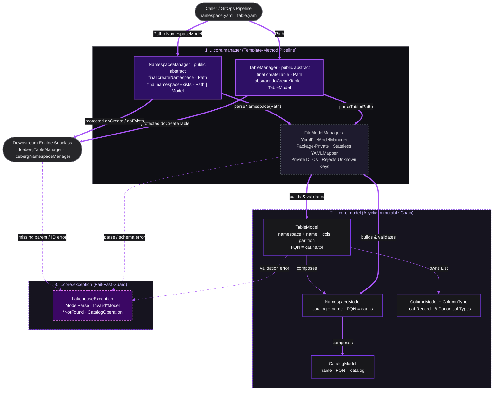

# Spec 01: `lakehouse-core` Contracts, Composable Models & YAML Parsers

| Field | Value |
| :--- | :--- |
| **Status** | `Approved` |
| **Owner** | Xavier Ruiz |
| **Component** | `lakehouse-core` (Pure Java 17 — Engine-Agnostic) |
| **Stack** | Java 17 · Jackson YAML (encapsulated) · JUnit 5 · AssertJ |
| **Archetype / Tier** | Software Library Contract · Full Spec (`18 REQs`, `19 TCs`) |
| **Depends On** | [Spec 00](./00_project_structure_and_organization.md) |

---

## 1. Overview & Design

### TL;DR
Passing raw catalog and namespace strings across services invites typos, scattered validation, and accidental auto-creation of missing platform resources. This spec establishes `lakehouse-core`: an acyclic, self-validating immutable domain model chain (`CatalogModel` → `NamespaceModel` → `TableModel` → `ColumnModel`), Template-Method manager base classes (`TableManager`, `NamespaceManager`), package-private YAML parsers, and a typed unchecked exception hierarchy. Downstream engine adapters (`lakehouse-iceberg`, future Delta/BigLake modules) extend these contracts with zero parsing boilerplate or serialization leakage.

### Architecture



### Key Design Decisions
- **Acyclic top-down model composition:** `CatalogModel` → `NamespaceModel` → `TableModel` → `ColumnModel` eliminates repeated raw identifier strings and makes circular object graphs impossible.
- **Platform-provisioned catalogs only:** Catalogs are provisioned externally by infrastructure—never via declarative YAML and never auto-created by managers—so `CatalogModel` stays a pure identity contract.
- **Unbypassable Template-Method managers:** Making `Path`-based entry points `public final` guarantees parsing and domain validation always fail fast before any subclass `do*` hook runs.
- **Package-private stateless YAML parsing:** Keeping `FileModelManager` and `YamlFileModelManager` package-private inside `...core.manager` with private DTOs keeps Jackson out of public APIs and domain records while preserving thread safety and clean future `.proto` support.

### Done Looks Like
- `mvn test -pl lakehouse-core` and full-reactor `mvn clean test` pass on Java 17 with zero Iceberg or Spark dependencies in `lakehouse-core`.
- All public contracts are immutable, strictly acyclic, thread-safe, free of serialization annotations on domain models, and keep YAML parsing strictly package-private inside `...core.manager`.
- Deterministic JUnit 5 + AssertJ unit tests verify acceptance cases `TC-001` through `TC-019`.

---

## 2. Scope

### In Scope
- Define the composable immutable domain models (`LakehouseModel`, `CatalogModel`, `NamespaceModel`, `TableModel`, `ColumnModel`) and canonical `ColumnType` enum in `...core.model`.
- Provide `public abstract` Template-Method base classes (`TableManager`, `NamespaceManager`) with `public final` entry points and `protected abstract` `do*` hooks in `...core.manager`.
- Implement package-private `FileModelManager` and stateless `YamlFileModelManager` (plus YAML test fixtures) hidden inside `...core.manager`.
- Define the custom unchecked exception hierarchy rooted at `LakehouseException` in `...core.exception`.
- Clean up `lakehouse-core` by replacing `Column`/`ColumnDefinition` with `ColumnModel`, removing unused `spark-sql_2.12` from `lakehouse-core/pom.xml`, and updating `lakehouse-iceberg/.../Main.java` only as needed to keep the reactor compiling.

### Out of Scope (Non-Goals)
- **No public YAML parser API or public `*Model` creation methods:** Callers use format-agnostic `Path` methods (plus `namespaceExists(NamespaceModel)`); YAML parsers stay package-private and raw `*Model` creation hooks stay `protected abstract`.
- **No `CatalogManager`, catalog YAML parser, or catalog/namespace properties:** Catalogs are platform-provisioned externally; connection configs and engine-specific properties live in engine modules.
- **No `lakehouse-iceberg` implementation:** `IcebergTableManager`, `IcebergNamespaceManager`, `IcebergTypeMapper`, and catalog factories belong to Spec 02.
- **No engine catalog/connection types in `lakehouse-core`:** Managers must never reference Iceberg `Catalog` or engine-specific clients.
- **No Protobuf/gRPC parsing implementation:** `ProtoFileModelManager` is deferred to a future spec.
- **No `dropTable`, `tableExists`, `dropNamespace`, or `alterTable`:** Only the operations explicitly listed in Section 4 are in scope.
- **No schema drift detection or schema evolution:** Idempotent `createTable` on an existing table follows pure `CREATE TABLE IF NOT EXISTS` no-op semantics.
- **No parameterized or nested column types yet:** `DECIMAL(p, s)`, `ARRAY<T>`, `MAP<K, V>`, and `STRUCT<...>` are deferred.
- **No partition transforms or multi-column partitioning:** Only a single identity `partitionColumn` is supported.

---

## 3. Functional Requirements

Exact signatures, fields, constructors, and YAML schemas live once in **Section 4**.

### Composable Domain Models & Validation

| ID | What | Why | How |
| :--- | :--- | :--- | :--- |
| `REQ-01` | Sealed `LakehouseModel` root contract | Enables exhaustive pattern matching and centralizes identifier validation rules | `sealed interface LakehouseModel` permits `CatalogModel`, `NamespaceModel`, `TableModel` with `name()`, `fullyQualifiedName()`, and static `validateIdentifier(...)` |
| `REQ-02` | Immutable `CatalogModel` identity | Prevents passing unvalidated raw catalog strings across services | Record holding validated `name` only (no engine connection properties); `fullyQualifiedName()` returns `name` |
| `REQ-03` | Composable `NamespaceModel` | Guarantees every namespace binds to a validated parent catalog | Record composing non-null `CatalogModel` and validated `name`; `fullyQualifiedName()` returns `"<catalog>.<namespace>"` |
| `REQ-04` | Composable `TableModel` | Guarantees every table carries validated namespace, catalog, columns, and partition metadata | Record composing non-null `NamespaceModel`, validated `name`, columns, and optional partition; exposes `catalog()` and `"<catalog>.<namespace>.<tableName>"` FQN |
| `REQ-05` | Uniform identifier format enforcement | Rejects malformed identifiers, dots, whitespace, and injection characters fail-fast | All model and column names must be non-null, non-blank, and match `^[a-zA-Z_][a-zA-Z0-9_]*$` |
| `REQ-06` | Closed canonical `ColumnType` enum | Decouples table schemas from engine-specific type systems | Enum of 8 canonical types (§4.2) with trimmed, case-insensitive `ColumnType.fromString(String)` |
| `REQ-07` | Standalone leaf `ColumnModel` record | Keeps column metadata immutable and acyclic without table back-pointers | Leaf record (not a `LakehouseModel`) validating `name` and non-null `type` |
| `REQ-08` | Table column list integrity | Prevents empty tables, null columns, duplicate names, and external mutation | Enforce at least one column, reject nulls and case-insensitive duplicate names, and defensively copy via `List.copyOf` |
| `REQ-09` | Optional identity `partitionColumn` validation | Prevents partitioning on blank or non-existent columns | `null` means unpartitioned; non-null must be non-blank and match an existing column name case-insensitively |

### Manager Template Contracts

| ID | What | Why | How |
| :--- | :--- | :--- | :--- |
| `REQ-10` | `TableManager` Template-Method flow | Ensures every engine enforces identical parse-validate-create ordering and idempotency | `public final createTable(Path)` parses via `FileModelManager`, checks non-null, and delegates to `protected abstract doCreateTable(TableModel)` (idempotent no-op if exists) |
| `REQ-11` | Strict parent checks in `doCreateTable` | Prevents silent creation of missing catalogs or namespaces during table DDL | Fail with `CatalogNotFoundException` (`spec.catalog()`) if catalog missing, or `NamespaceNotFoundException` (`spec.namespace()`) if namespace missing |
| `REQ-12` | `NamespaceManager.createNamespace` flow | Standardizes declarative namespace provisioning with strict catalog guards and idempotency | `public final createNamespace(Path)` parses, checks non-null, and delegates to `protected abstract doCreateNamespace(NamespaceModel)` (fails if catalog missing; idempotent no-op if exists) |
| `REQ-13` | `NamespaceManager.namespaceExists` overloads | Supports both GitOps file checks and typed model checks without duplicating guards | `public final namespaceExists(Path)` delegates to `public final namespaceExists(NamespaceModel)`, which rejects `null` and delegates to `protected abstract doNamespaceExists(NamespaceModel)` |

### Internal YAML File Parsers (Package-Private)

| ID | What | Why | How |
| :--- | :--- | :--- | :--- |
| `REQ-14` | Table YAML parsing | Translates GitOps table specs directly into the validated model chain | `YamlFileModelManager.parseTable(Path)` maps `catalog`, `namespace`, `tableName`, `columns`, and optional `partitionColumn` into `TableModel` |
| `REQ-15` | Default column nullability | Keeps YAML concise while matching SQL/lakehouse nullable defaults | When `nullable` is omitted for a column in YAML, default `nullable` to `true` |
| `REQ-16` | Namespace YAML parsing | Translates GitOps namespace specs into validated `NamespaceModel` | `YamlFileModelManager.parseNamespace(Path)` maps `catalog` and `namespace` into `NamespaceModel` |
| `REQ-17` | Encapsulated stateless parser & manager ctors | Hides Jackson from callers, catches YAML typos fail-fast, and enables internal format testing | Keep `FileModelManager` and `final YamlFileModelManager` package-private in `...core.manager` with private DTOs and unknown-property rejection; managers expose `protected ()` and package-private `(FileModelManager)` ctors |

### Error Handling

| ID | What | Why | How |
| :--- | :--- | :--- | :--- |
| `REQ-18` | Unified unchecked exception hierarchy | Lets callers handle domain, parse, and catalog failures cleanly without checked-exception noise | All domain, parsing, not-found, and catalog failures extend abstract `LakehouseException` (§4.5) |

---

## 4. Contract & Blueprint

### 4.1 Package Layout & Template Flow

```text
x.ruiz.playground.data.engineering.lakehouse.core/
├── model/       # LakehouseModel, CatalogModel, NamespaceModel, TableModel, ColumnModel, ColumnType
├── manager/     # public: TableManager, NamespaceManager; pkg-private: FileModelManager, YamlFileModelManager
└── exception/   # LakehouseException and all 7 domain/parse/catalog subclasses
```

```text
Caller (lakehouse-iceberg / application)
  │
  ├─► TableManager.createTable(Path)                         [public final]
  │     ├─► FileModelManager.parseTable(Path)                [pkg-private → YamlFileModelManager]
  │     │     ├─► readFile(Path, YamlTableDto.class, "table")
  │     │     └─► validates CatalogModel → NamespaceModel → TableModel
  │     └─► doCreateTable(TableModel)                        [protected abstract — engine subclass]
  │
  ├─► NamespaceManager.createNamespace(Path)                 [public final]
  │     ├─► FileModelManager.parseNamespace(Path)            [pkg-private → YamlFileModelManager]
  │     │     ├─► readFile(Path, YamlNamespaceDto.class, "namespace")
  │     │     └─► validates CatalogModel → NamespaceModel
  │     └─► doCreateNamespace(NamespaceModel)                [protected abstract — engine subclass]
  │
  └─► NamespaceManager.namespaceExists(Path | NamespaceModel) [public final]
        ├─► (if Path) FileModelManager.parseNamespace(Path)
        ├─► non-null guard → InvalidNamespaceModelException
        └─► doNamespaceExists(NamespaceModel)                [protected abstract — engine subclass]
```

### 4.2 Public Domain Models (`...lakehouse.core.model`)

Acyclic chain: `CatalogModel` → `NamespaceModel` → `TableModel` → `List<ColumnModel>` (zero circular references).

| Type | Kind | Key Fields & Rules |
| :--- | :--- | :--- |
| `LakehouseModel` | `public sealed interface` | Permits `CatalogModel`, `NamespaceModel`, `TableModel`. Declares `name()`, `fullyQualifiedName()`, and static `validateIdentifier(fieldName, value, exceptionFactory)` enforcing `^[a-zA-Z_][a-zA-Z0-9_]*$`. |
| `CatalogModel` | `public record` (`LakehouseModel`) | `name` (`String`). Validates `name` (`InvalidCatalogModelException`). `fullyQualifiedName()` returns `name`. |
| `NamespaceModel` | `public record` (`LakehouseModel`) | `catalog` (`CatalogModel`), `name` (`String`). Enforces non-null `catalog` and valid `name` (`InvalidNamespaceModelException`). `fullyQualifiedName()` returns `"<catalog>.<namespace>"`. |
| `TableModel` | `public record` (`LakehouseModel`) | `namespace` (`NamespaceModel`), `name` (`String`), `columns` (`List<ColumnModel>`), `partitionColumn` (`String`, nullable). Enforces non-null `namespace`, valid `name`, non-empty/non-null/case-insensitively unique `columns` via `List.copyOf`, and `partitionColumn` membership (`InvalidTableModelException`). Exposes `catalog()`, `fullyQualifiedName()` (`"<catalog>.<namespace>.<tableName>"`), `isPartitioned()`, and `partitionColumnOptional()`. |
| `ColumnModel` | `public record` *(leaf)* | `name` (`String`), `type` (`ColumnType`), `nullable` (`boolean`). Not a `LakehouseModel`; holds no table back-pointer. Validates `name` and non-null `type` (`InvalidTableModelException`). |
| `ColumnType` | `public enum` | Values: `STRING`, `INT`, `BIGINT`, `DOUBLE`, `BOOLEAN`, `DATE`, `TIMESTAMP`, `DECIMAL`. Static `fromString(String)` trims and parses case-insensitively; throws `InvalidTableModelException` on null, blank, or unknown input. |

### 4.3 Public Manager Ports (`...lakehouse.core.manager`)

| Type | Operation / Constructor | Behavioral Contract |
| :--- | :--- | :--- |
| `TableManager` | `protected TableManager()` | Default subclass constructor wiring `YamlFileModelManager.INSTANCE`. |
| `TableManager` | `TableManager(FileModelManager)` *(pkg-private)* | Internal constructor for format routing/tests; fails fast with `IllegalArgumentException` on `null` parser. |
| `TableManager` | `public final void createTable(Path)` | Parses via `FileModelManager.parseTable(Path)`, rejects `null` model (`InvalidTableModelException`), then invokes `doCreateTable(TableModel)`. |
| `TableManager` | `protected abstract void doCreateTable(TableModel)` | Engine hook; throws `CatalogNotFoundException` if catalog missing, `NamespaceNotFoundException` if namespace missing, and acts as an idempotent no-op if table exists. |
| `NamespaceManager` | `protected NamespaceManager()` | Default subclass constructor wiring `YamlFileModelManager.INSTANCE`. |
| `NamespaceManager` | `NamespaceManager(FileModelManager)` *(pkg-private)* | Internal constructor for format routing/tests; fails fast with `IllegalArgumentException` on `null` parser. |
| `NamespaceManager` | `public final void createNamespace(Path)` | Parses via `FileModelManager.parseNamespace(Path)`, rejects `null` model (`InvalidNamespaceModelException`), then invokes `doCreateNamespace(NamespaceModel)`. |
| `NamespaceManager` | `public final boolean namespaceExists(Path)` | Parses `Path` into `NamespaceModel` and delegates to `namespaceExists(NamespaceModel)`. |
| `NamespaceManager` | `public final boolean namespaceExists(NamespaceModel)` | Rejects `null` with `InvalidNamespaceModelException` and delegates to `doNamespaceExists(NamespaceModel)`. |
| `NamespaceManager` | `protected abstract void doCreateNamespace(NamespaceModel)` | Engine hook; throws `CatalogNotFoundException` if catalog missing; idempotent no-op if namespace exists. |
| `NamespaceManager` | `protected abstract boolean doNamespaceExists(NamespaceModel)` | Engine hook; throws `CatalogNotFoundException` if catalog missing; returns current namespace existence. |

### 4.4 Internal Parser Contracts (`...lakehouse.core.manager` — Package-Private)

| Type | Operation / Member | Behavioral Contract |
| :--- | :--- | :--- |
| `FileModelManager` *(interface)* | `parseTable(Path)` → `TableModel` | Format-specific parser contract hidden outside `...core.manager` (YAML today; `.proto` in v2). |
| `FileModelManager` *(interface)* | `parseNamespace(Path)` → `NamespaceModel` | Parses declarative namespace file into validated `NamespaceModel` (no `parseCatalog` by design). |
| `FileModelManager` *(interface)* | `<D> D readFile(Path, Class<D>, String)` | Shared low-level file deserialization hook wrapping I/O, empty-file, and syntax errors in `ModelParseException`. |
| `YamlFileModelManager` *(`final class`)* | `INSTANCE` + pkg-private no-arg ctor | Stateless, thread-safe implementation using one `private static final YAMLMapper` and private DTOs; rejects unknown YAML properties; defaults omitted column `nullable` to `true`. |

### 4.5 Error Hierarchy (`...lakehouse.core.exception`)

| Error Type | Parent | Constructors & Extra Members | When Thrown |
| :--- | :--- | :--- | :--- |
| `LakehouseException` | `RuntimeException` (`abstract`) | `(String)`, `(String, Throwable)` | Root unchecked exception for all `lakehouse-core` domain and parsing errors. |
| `InvalidCatalogModelException` | `LakehouseException` | `(String)`, `(String, Throwable)` | Invalid `CatalogModel.name` or `null` passed to `CatalogNotFoundException`. |
| `InvalidNamespaceModelException` | `LakehouseException` | `(String)`, `(String, Throwable)` | Invalid `NamespaceModel`, `null` passed to `namespaceExists(NamespaceModel)` or `NamespaceNotFoundException`, or `null` returned by parser. |
| `InvalidTableModelException` | `LakehouseException` | `(String)`, `(String, Throwable)` | Invalid `TableModel`, `ColumnModel`, or `ColumnType`, or `null` returned by parser. |
| `ModelParseException` | `LakehouseException` | `(String)`, `(String, Throwable)` | `null` `Path`, missing/unreadable file, empty YAML, malformed syntax, or unknown YAML key. |
| `CatalogNotFoundException` | `LakehouseException` | `(CatalogModel)`, `(CatalogModel, Throwable)`; `getCatalogModel()`, `getFullyQualifiedName()` | Target catalog has not been platform-provisioned during `createNamespace`, `namespaceExists`, or `createTable`. |
| `NamespaceNotFoundException` | `LakehouseException` | `(NamespaceModel)`, `(NamespaceModel, Throwable)`; `getNamespaceModel()`, `getFullyQualifiedName()` | Target namespace does not exist within an existing catalog during `createTable`. |
| `CatalogOperationException` | `LakehouseException` | `(String)`, `(String, Throwable)` | Unexpected catalog, network, or storage failure inside an engine manager subclass. |

### 4.6 Declarative YAML Payloads

```yaml
# table.yaml (preserves existing keys)
catalog: data_lake
namespace: market_data
tableName: transactions
columns:
  - name: date
    type: DATE
    nullable: false
  - name: id
    type: BIGINT
    nullable: false
  - name: amount
    type: DECIMAL
    nullable: true
partitionColumn: date
```

```yaml
# namespace.yaml
catalog: data_lake
namespace: market_data
```

---

## 5. Invariants & Failure Modes

### Key Invariants
- **Strict immutability & acyclicity:** All model records are deeply immutable and strictly one-directional; mutating a caller's column list after construction has no effect, and mutating `spec.columns()` throws `UnsupportedOperationException`.
- **Engine independence:** Zero imports from `org.apache.iceberg.*` or `org.apache.spark.*` exist anywhere in `lakehouse-core`.
- **Thread safety:** `YamlFileModelManager` holds no per-call mutable state (reusing one `private static final YAMLMapper`) and supports concurrent multi-threaded reads.
- **Unbypassable template & parser encapsulation:** `FileModelManager` and `YamlFileModelManager` are package-private in `...core.manager`, and all public manager methods are `final`, ensuring `do*` hooks never run on parse or validation failure.
- **No silent parent creation:** Catalogs must be platform-provisioned (never auto-created); `TableManager.doCreateTable` must reject missing namespaces with `NamespaceNotFoundException`.
- **No exception swallowing:** Every wrapped exception preserves its original `Throwable cause`.

### Failure Modes

| Condition | Expected Behavior | Guarantee |
| :--- | :--- | :--- |
| `sourcePath` is `null` (via managers or `YamlFileModelManager`) | Throws `ModelParseException` | Fails fast; `do*` hooks never invoked |
| Missing or unreadable file (`IOException`) | Throws `ModelParseException` | Preserves `IOException` cause; hooks not invoked |
| Malformed YAML syntax or unknown property | Throws `ModelParseException` | Preserves Jackson cause; hooks not invoked |
| Empty or comment-only YAML file | Throws `ModelParseException` | Rejects `null` deserialization; hooks not invoked |
| Missing, blank, or invalid `CatalogModel.name` | Throws `InvalidCatalogModelException` | Applies to direct ctor and YAML; hooks not invoked |
| `NamespaceModel` with `null` catalog or invalid `name` | Throws `InvalidNamespaceModelException` | Applies to direct ctor and YAML; hooks not invoked |
| `TableModel` with `null` namespace, invalid `name`, empty/null/duplicate columns, or bad `partitionColumn` | Throws `InvalidTableModelException` | Case-insensitive duplicate check; `null` partition valid, blank invalid |
| Invalid `ColumnModel.name`, `null` `ColumnType`, or unknown/blank `ColumnType.fromString` | Throws `InvalidTableModelException` | Error message names offending type value |
| `NamespaceManager.namespaceExists((NamespaceModel) null)` | Throws `InvalidNamespaceModelException` | Enforced once by base class; `doNamespaceExists` not invoked |
| Package-private manager constructor given `null` `FileModelManager` | Throws `IllegalArgumentException` | Fails fast at construction |
| Custom internal `FileModelManager` returns `null` model | Throws `InvalidTableModelException` / `InvalidNamespaceModelException` | Enforced by base class; `do*` hooks not invoked |
| Target catalog missing during `createNamespace`, `namespaceExists`, or `createTable` | Throws `CatalogNotFoundException` | Exposes `getCatalogModel()` and FQN; never auto-creates catalog |
| Target namespace missing within existing catalog during `createTable` | Throws `NamespaceNotFoundException` | Exposes `getNamespaceModel()` and FQN; never auto-creates namespace |
| Underlying catalog, network, or storage failure | Throws `CatalogOperationException` | Preserves underlying `Throwable` cause |

---

## 6. Acceptance & Verification (`TC-*`)

| Case | Scenario | Pass Condition |
| :--- | :--- | :--- |
| `TC-001` (`REQ-01`–`04`, `REQ-14`) | Valid table YAML (happy path) | `YamlFileModelManager.parseTable(path)` returns `TableModel` with FQN `"data_lake.market_data.transactions"`, namespace FQN `"data_lake.market_data"`, catalog FQN `"data_lake"`, 3 typed columns (`DATE`, `BIGINT`, `DECIMAL`), and `partitionColumn == "date"` (`isPartitioned() == true`). |
| `TC-002` (`REQ-09`, `REQ-15`) | Unpartitioned table & default nullability | Valid YAML omitting `partitionColumn` and column `nullable` returns `isPartitioned() == false`, `partitionColumnOptional().isEmpty()`, and `nullable == true`. |
| `TC-003` (`REQ-06`) | Case-insensitive `ColumnType` parsing | `" date "` and `ColumnType.fromString("bigint")` parse cleanly to `ColumnType.DATE` and `ColumnType.BIGINT`. |
| `TC-004` (`REQ-06`, `REQ-07`) | Invalid `ColumnType` | Column type `"VARCHR"` or `null` throws `InvalidTableModelException` mentioning the invalid type. |
| `TC-005` (`REQ-05`) | Invalid identifier format at each level | `null`, blank, or dot/space-containing `name` (e.g., `"market.data"`) throws `InvalidCatalogModelException`, `InvalidNamespaceModelException`, or `InvalidTableModelException`. |
| `TC-006` (`REQ-03`, `REQ-04`) | Null parent composition | `new NamespaceModel(null, "ns")` and `new TableModel(null, "tbl", cols, null)` throw `InvalidNamespaceModelException` and `InvalidTableModelException`—never `NullPointerException`. |
| `TC-007` (`REQ-08`) | Empty, null, or duplicate columns | Empty column list, `null` entry, or duplicate names `["id", "ID"]` throw `InvalidTableModelException`. |
| `TC-008` (`REQ-09`) | Invalid `partitionColumn` | `partitionColumn` set to `"non_existent"` or `"  "` throws `InvalidTableModelException`. |
| `TC-009` (`REQ-17`) | Unknown YAML key in table YAML | Typo key such as `partitonColumn: date` causes `parseTable` to throw `ModelParseException` preserving Jackson cause. |
| `TC-010` (`REQ-14`, `REQ-16`) | Missing, unreadable, or malformed YAML | Non-existent `Path`, `null` `Path`, empty file, or bad YAML syntax throws `ModelParseException` (with cause when applicable) for both `parseTable` and `parseNamespace`. |
| `TC-011` (`REQ-03`, `REQ-16`) | Valid namespace YAML (happy path) | `YamlFileModelManager.parseNamespace(path)` on `namespace.yaml` returns `NamespaceModel` with `catalog().fullyQualifiedName() == "data_lake"` and `fullyQualifiedName() == "data_lake.market_data"`. |
| `TC-012` (`REQ-16`, `REQ-17`) | Invalid namespace YAML | Missing `catalog`/`namespace` or invalid identifier throws `InvalidCatalogModelException`/`InvalidNamespaceModelException`; unknown key or bad syntax throws `ModelParseException`. |
| `TC-013` (`REQ-08`) | Defensive immutability | Mutating caller's source `List` leaves `TableModel.columns()` unchanged; calling `.add()` on `spec.columns()` throws `UnsupportedOperationException`. |
| `TC-014` (`REQ-18`) | Exception hierarchy & metadata | `CatalogNotFoundException` and `NamespaceNotFoundException` extend `LakehouseException`, expose typed models and FQNs, include FQNs in messages, reject `null` models with `Invalid*ModelException`, and preserve causes (as do `CatalogOperationException` and `ModelParseException`). |
| `TC-015` (`REQ-10`–`13`) | Template managers, catalog guard & idempotency | In-memory manager subclasses reject missing catalogs with `CatalogNotFoundException` (never auto-creating); once catalog exists, missing namespace throws `NamespaceNotFoundException`, repeated `createNamespace` flips `namespaceExists` from `false` to `true` idempotently, and repeated `createTable` succeeds idempotently. |
| `TC-016` (`REQ-17`) | Concurrent parser usage | Invoking `YamlFileModelManager.INSTANCE.parseTable(path)` concurrently across multiple threads returns equal `TableModel` instances with zero errors. |
| `TC-017` (`REQ-01`, `REQ-18`) | Build & module hygiene | Full-reactor `mvn clean test` compiles on Java 17 and passes all tests with zero Spark or Iceberg dependencies in `lakehouse-core/pom.xml`. |
| `TC-018` (`REQ-10`, `REQ-12`, `REQ-17`) | Encapsulation & template modifiers | `FileModelManager` and `final YamlFileModelManager` are package-private in `...core.manager` (no `...core.parser` package); `TableManager` and `NamespaceManager` are `public abstract` with `public final` template methods and `protected abstract` `do*` hooks. |
| `TC-019` (`REQ-10`, `REQ-12`, `REQ-13`, `REQ-17`) | Parse, semantic & null failures skip hooks | `null` `Path`, missing/malformed/invalid YAML, `namespaceExists((NamespaceModel) null)`, and a stub `FileModelManager` returning `null` throw expected exceptions with `0` hook invocations; `null` parser in package-private ctor throws `IllegalArgumentException`. |
