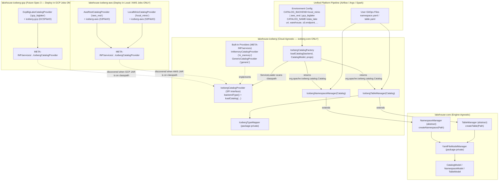
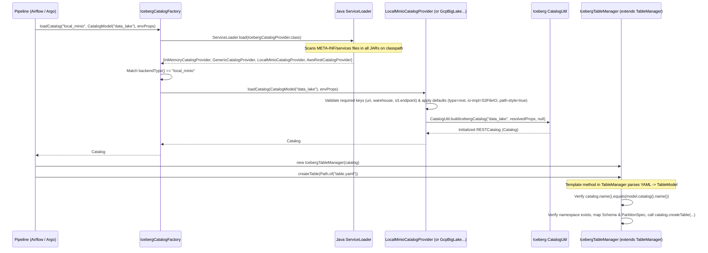

# Feature Spec: `lakehouse-iceberg` Core Adapter, Catalog SPI & `lakehouse-iceberg-aws` Plugin

- **Status:** Approved
- **Modules / Components:** `lakehouse-iceberg` (Cloud-Agnostic Core Adapter) + `lakehouse-iceberg-aws` (AWS / Local MinIO SPI Plugin) — Java 17, Apache Iceberg `1.7.2`
- **Archetype:** Software Library Contract (Engine Adapter + Plugin SPI)
- **Tier:** Mini-Spec
- **Owner:** Xavier Ruiz
- **Depends On:** `specs/00_project_structure_and_organization.md`, `specs/01_lakehouse_core_contracts.md`

---

## 1. Goal & Context

### Problem Statement
`lakehouse-core` provides engine-agnostic domain models (`CatalogModel`, `NamespaceModel`, `TableModel`, `ColumnModel`, `ColumnType`), Template-Method managers (`TableManager`, `NamespaceManager`), and deterministic exceptions (`CatalogNotFoundException`, `NamespaceNotFoundException`, `CatalogOperationException`). In production data platforms (Airflow, Argo, Spark), a single pipeline codebase must provision Iceberg namespaces and tables across local Docker REST + MinIO, AWS REST, and future GCP BigLake REST purely via environment configuration—while keeping runtime/shaded fat JARs lean so a GCP Spark job never loads AWS SDK JARs (and vice versa). Splitting cloud-specific catalog providers and `FileIO` dependencies into thin plugin modules discovered via Java's `ServiceLoader` SPI achieves both a single unified pipeline and minimal, conflict-free runtime JARs.

### Success Metrics
- `lakehouse-iceberg` compiles and passes all unit tests (`TC-001` through `TC-014`) with **zero** AWS or GCP dependencies (`iceberg-aws` and `iceberg-aws-bundle` removed from `lakehouse-iceberg/pom.xml`).
- `lakehouse-iceberg-aws` cleanly plugs into `IcebergCatalogFactory` via `META-INF/services` (`ServiceLoader`), passing all provider validation and SPI discovery unit tests (`TC-015` through `TC-017`) with zero Docker dependency.
- An opt-in Docker REST + MinIO integration test (`IcebergRestCatalogIT`, `TC-018`) verifies live end-to-end namespace and table creation in `lakehouse-iceberg-aws` without running during normal `mvn clean test`.
- All new production classes pass strict Javadoc validation (`mvn javadoc:javadoc -Ddoclint=all`) with 0 errors and 0 warnings.

---

## 2. Scope & Explicit Non-Goals

### In Scope
- **Cloud-agnostic `lakehouse-iceberg` module** (depends on `lakehouse-core` + `iceberg-core`; removes `iceberg-aws` and `iceberg-aws-bundle`):
  - Root package `...lakehouse.iceberg`:
    - `IcebergNamespaceManager` (`public final class extends NamespaceManager`)
    - `IcebergTableManager` (`public final class extends TableManager`)
    - `IcebergTypeMapper` (*(package-private)* `final class`)
  - Catalog SPI subsystem `...lakehouse.iceberg.catalog` (3+ cohesive classes per Spec 00):
    - `IcebergCatalogProvider` (`public interface` SPI)
    - `IcebergCatalogFactory` (`public final class`, `ServiceLoader`-backed)
    - `InMemoryCatalogProvider` (`public final class implements IcebergCatalogProvider`, backend `"in_memory"`)
    - `GenericCatalogProvider` (`public final class implements IcebergCatalogProvider`, backend `"generic"`)
  - `META-INF/services/...IcebergCatalogProvider` registering `InMemoryCatalogProvider` and `GenericCatalogProvider`.
- **Thin `lakehouse-iceberg-aws` plugin module** (added to root reactor `pom.xml`; depends on `lakehouse-iceberg` + `iceberg-aws` + `iceberg-aws-bundle`, with `maven-shade-plugin` `ServicesResourceTransformer`):
  - Package `...lakehouse.iceberg.aws`:
    - `LocalMinioCatalogProvider` (`public final class implements IcebergCatalogProvider`, backend `"local_minio"`)
    - `AwsRestCatalogProvider` (`public final class implements IcebergCatalogProvider`, backend `"aws_rest"`)
  - `META-INF/services/...IcebergCatalogProvider` registering `LocalMinioCatalogProvider` and `AwsRestCatalogProvider`.
  - Opt-in live Docker REST + MinIO integration test `IcebergRestCatalogIT` (`@Tag("integration")`).
- Deterministic unit tests (`*Test`) across both modules using `InMemoryCatalog` and provider property-resolution tests.
- Synchronization of `specs/00_project_structure_and_organization.md` to document `lakehouse-<engine>-<cloud>` plugin modules and `...iceberg.catalog`.

### Non-Goals (Do Not Implement)
- **No `lakehouse-iceberg-gcp` module yet:** GCP BigLake Iceberg REST (`GcpBigLakeCatalogProvider`, `iceberg-gcp`, Google ADC/OAuth auth) is deferred to Spec 3, where it will drop in cleanly as a sibling plugin JAR implementing `IcebergCatalogProvider`.
- **No application-level catalog registry or stored catalog state:** Pipelines pass one environment-configured `Catalog` instance into `IcebergNamespaceManager` / `IcebergTableManager`.
- **No `dropTable`, `tableExists`, `dropNamespace`, `alterTable`, or schema evolution:** Table creation follows strict idempotent `CREATE TABLE IF NOT EXISTS` no-op semantics without schema drift detection.
- **No multi-column partitioning or partition transforms:** Only single identity partition column or `PartitionSpec.unpartitioned()`.
- **No custom table/namespace properties propagation yet:** `createNamespace` passes empty properties and `createTable` uses catalog defaults.
- **No Spark session / Spark SQL execution:** Managers use the native Apache Iceberg Java Catalog API.

---

## 3. Functional Requirements

### Catalog SPI & Factory (`lakehouse-iceberg` — `...iceberg.catalog`)
- `REQ-01`: `IcebergCatalogProvider` shall be a `public interface` declaring `String backendType()` and `Catalog loadCatalog(CatalogModel catalogModel, Map<String, String> properties)`.
- `REQ-02`: `IcebergCatalogFactory` shall be a `public final class` (private constructor) exposing:
  - `public static Catalog loadCatalog(String backendType, CatalogModel catalogModel, Map<String, String> properties)`
  - `public static Set<String> availableBackends()` (unmodifiable sorted set of discovered backend IDs)
  - A package-private `loadCatalog(..., Iterable<IcebergCatalogProvider>)` overload for deterministic unit testing.
- `REQ-03`: `IcebergCatalogFactory` shall discover providers via `java.util.ServiceLoader.load(IcebergCatalogProvider.class)`, normalize `backendType` via trim + lowercase (`Locale.ROOT`), fail fast with `CatalogOperationException` on `null`/blank `backendType`, duplicate provider registrations for the same `backendType`, or unknown `backendType` (listing discovered backends in the error message), and fail fast with `InvalidCatalogModelException` if `catalogModel` is `null`.
- `REQ-04`: `InMemoryCatalogProvider` (`backendType() == "in_memory"`) shall load `org.apache.iceberg.inmemory.InMemoryCatalog` via `CatalogUtil.buildIcebergCatalog(catalogModel.name(), resolvedProps, null)`, defaulting `warehouse` to `"memory://warehouse"` when omitted, rejecting `null` keys/values in caller properties with `CatalogOperationException`, and wrapping Iceberg load failures in `CatalogOperationException` preserving cause.
- `REQ-05`: `GenericCatalogProvider` (`backendType() == "generic"`) shall reject `null` `CatalogModel` with `InvalidCatalogModelException`, reject `null`/empty `properties` or `null` keys/values with `CatalogOperationException`, defensively copy properties, and delegate directly to `CatalogUtil.buildIcebergCatalog(catalogModel.name(), copiedProps, null)`, wrapping any Iceberg failure in `CatalogOperationException` preserving cause.

### AWS / Local MinIO Plugin (`lakehouse-iceberg-aws` — `...iceberg.aws`)
- `REQ-06`: `lakehouse-iceberg-aws` shall be a sibling Maven module depending on `lakehouse-iceberg`, `iceberg-aws`, and `iceberg-aws-bundle`; `lakehouse-iceberg` shall have zero compile/runtime dependency on `iceberg-aws` or `iceberg-aws-bundle`.
- `REQ-07`: `LocalMinioCatalogProvider` (`backendType() == "local_minio"`) shall require non-blank `uri`, `warehouse`, and `s3.endpoint` properties (failing fast with `CatalogOperationException` if missing/blank or if any property key/value is `null`), default `type` to `"rest"`, `io-impl` to `"org.apache.iceberg.aws.s3.S3FileIO"`, and `s3.path-style-access` to `"true"` (preserving additional caller properties such as credentials/region), and load the catalog via `CatalogUtil.buildIcebergCatalog(catalogModel.name(), resolvedProps, null)`.
- `REQ-08`: `AwsRestCatalogProvider` (`backendType() == "aws_rest"`) shall require non-blank `uri` and `warehouse` properties (failing fast with `CatalogOperationException` if missing/blank or if any property key/value is `null`), default `type` to `"rest"` and `io-impl` to `"org.apache.iceberg.aws.s3.S3FileIO"`, default `rest.sigv4-enabled` to `"true"` when `rest.signing-region` is present and `rest.sigv4-enabled` is not explicitly set, preserve additional caller properties, and load via `CatalogUtil.buildIcebergCatalog(catalogModel.name(), resolvedProps, null)`.
- `REQ-09`: Both `lakehouse-iceberg` and `lakehouse-iceberg-aws` shall register their providers in `src/main/resources/META-INF/services/x.ruiz.playground.data.engineering.lakehouse.iceberg.catalog.IcebergCatalogProvider`, and `maven-shade-plugin` in `lakehouse-iceberg-aws` shall include `ServicesResourceTransformer` so shaded fat JARs merge SPI registrations cleanly.

### Manager Construction & Catalog Identity Guard (`lakehouse-iceberg`)
- `REQ-10`: `IcebergNamespaceManager` (`public final class extends NamespaceManager`) and `IcebergTableManager` (`public final class extends TableManager`) shall each accept a single `org.apache.iceberg.catalog.Catalog` via constructor.
- `REQ-11`: Both constructors shall fail fast with `CatalogOperationException` if `catalog` is `null`, if `catalog.name()` is `null` or blank, or if `catalog` does not implement `org.apache.iceberg.catalog.SupportsNamespaces`.
- `REQ-12`: Before performing any Iceberg operation, both managers shall verify exact catalog-name equality (`catalog.name().equals(model.catalog().name())`). On mismatch, they shall throw `CatalogNotFoundException` carrying `model.catalog()` and never invoke any Iceberg mutation or auto-create a catalog.

### Namespace & Table Management (`lakehouse-iceberg`)
- `REQ-13`: `IcebergNamespaceManager.doNamespaceExists(NamespaceModel)` shall validate catalog identity (`REQ-12`), translate `model` to `Namespace.of(model.name())`, and return `supportsNamespaces.namespaceExists(namespace)`.
- `REQ-14`: `IcebergNamespaceManager.doCreateNamespace(NamespaceModel)` shall validate catalog identity (`REQ-12`), return cleanly if the namespace already exists, otherwise call `supportsNamespaces.createNamespace(namespace)`, and treat `AlreadyExistsException` as an idempotent no-op.
- `REQ-15`: `IcebergTableManager.doCreateTable(TableModel)` shall validate catalog identity (`REQ-12`), check `supportsNamespaces.namespaceExists(namespace)` and throw `NamespaceNotFoundException` carrying `model.namespace()` if missing (never auto-creating namespaces), return cleanly if `catalog.tableExists(tableId)` is `true`, otherwise map `TableModel` via `IcebergTypeMapper` and call `catalog.createTable(tableId, schema, partitionSpec)`.
- `REQ-16`: In `IcebergTableManager.doCreateTable`, catching `AlreadyExistsException` shall be treated as an idempotent no-op, and catching `NoSuchNamespaceException` shall throw `NamespaceNotFoundException(model.namespace(), cause)`. In both managers, any other unexpected `RuntimeException` (excluding `LakehouseException`) shall be wrapped in `CatalogOperationException` preserving the original cause.

### Schema, Type, Partition & Identifier Mapping (`IcebergTypeMapper`)
- `REQ-17`: `IcebergTypeMapper` shall be a package-private `final class` (private constructor) in `...lakehouse.iceberg`.
- `REQ-18`: `IcebergTypeMapper.toIcebergSchema(List<ColumnModel>)` shall assign deterministic sequential 1-based Iceberg field IDs (`1..N`), mapping `nullable == true` to `Types.NestedField.optional` and `nullable == false` to `Types.NestedField.required` using an exhaustive switch over `ColumnType` (`TIMESTAMP` → `TimestampType.withZone()`, `DECIMAL` → `DecimalType.of(38, 9)`).
- `REQ-19`: `IcebergTypeMapper.toPartitionSpec(Schema, TableModel)` shall return `PartitionSpec.unpartitioned()` when unpartitioned and `PartitionSpec.builderFor(schema).identity(model.partitionColumn()).build()` when partitioned; `toIcebergNamespace` shall return `Namespace.of(model.name())`; `toIcebergTableIdentifier` shall return `TableIdentifier.of(Namespace.of(model.namespace().name()), model.name())`.

---

## 4. Public Java API & Module Contract

### Multi-Module Plugin Architecture



### Runtime Flow: How Environment Config Maps to the Right Provider Class



```text
sdk_lakehouse/
├── lakehouse-core/                     # Engine-agnostic models, Template-Method managers, YAML FileModelManager
├── lakehouse-iceberg/                  # Cloud-agnostic Iceberg adapter (iceberg-core ONLY; zero cloud SDKs)
│   ├── ...lakehouse.iceberg/
│   │   ├── IcebergNamespaceManager     (public final extends NamespaceManager)
│   │   ├── IcebergTableManager         (public final extends TableManager)
│   │   └── IcebergTypeMapper           (package-private final)
│   ├── ...lakehouse.iceberg.catalog/
│   │   ├── IcebergCatalogProvider      (public SPI interface)
│   │   ├── IcebergCatalogFactory       (public final — ServiceLoader discovery)
│   │   ├── InMemoryCatalogProvider     (backend: "in_memory")
│   │   └── GenericCatalogProvider      (backend: "generic")
│   └── src/main/resources/META-INF/services/...IcebergCatalogProvider
├── lakehouse-iceberg-aws/              # Thin AWS / MinIO plugin JAR (lakehouse-iceberg + iceberg-aws + bundle)
│   ├── ...lakehouse.iceberg.aws/
│   │   ├── LocalMinioCatalogProvider   (backend: "local_minio")
│   │   └── AwsRestCatalogProvider      (backend: "aws_rest")
│   ├── src/main/resources/META-INF/services/...IcebergCatalogProvider
│   └── src/test/java/.../aws/IcebergRestCatalogIT  (@Tag("integration"), opt-in Docker REST + MinIO)
└── lakehouse-iceberg-gcp/              # Future Spec 3: Thin GCP BigLake plugin JAR (zero AWS deps)
```

### Public & Package-Private Types (`lakehouse-iceberg`)

| Type | Package & Visibility | Operations / Constructors | Contract |
| :--- | :--- | :--- | :--- |
| `IcebergNamespaceManager` | `...iceberg` (`public final class extends NamespaceManager`) | `public IcebergNamespaceManager(Catalog)`<br/>Overrides `protected doCreateNamespace(NamespaceModel)` & `protected doNamespaceExists(NamespaceModel)` | Validates `Catalog` (non-null, non-blank name, `SupportsNamespaces`) at construction; enforces catalog name match (`CatalogNotFoundException`), idempotent creation (`AlreadyExistsException` no-op), and wraps unexpected errors in `CatalogOperationException`. |
| `IcebergTableManager` | `...iceberg` (`public final class extends TableManager`) | `public IcebergTableManager(Catalog)`<br/>Overrides `protected doCreateTable(TableModel)` | Validates `Catalog` at construction; enforces catalog match (`CatalogNotFoundException`), strict namespace check (`NamespaceNotFoundException`), idempotent table creation (`tableExists` + `AlreadyExistsException`), and wraps unexpected errors in `CatalogOperationException`. |
| `IcebergTypeMapper` | `...iceberg` *(package-private `final class`)* | `static toIcebergType(ColumnType)`<br/>`static toIcebergSchema(List<ColumnModel>)`<br/>`static toPartitionSpec(Schema, TableModel)`<br/>`static toIcebergNamespace(NamespaceModel)`<br/>`static toIcebergTableIdentifier(TableModel)` | Pure deterministic Iceberg schema, partition, and identifier translation with exhaustive `ColumnType` switch. |
| `IcebergCatalogProvider` | `...iceberg.catalog` (`public interface`) | `String backendType()`<br/>`Catalog loadCatalog(CatalogModel, Map<String, String>)` | SPI contract implemented by built-in and cloud plugin JARs and discovered via `ServiceLoader`. |
| `IcebergCatalogFactory` | `...iceberg.catalog` (`public final class`) | `static loadCatalog(String, CatalogModel, Map<String, String>)` → `Catalog`<br/>`static availableBackends()` → `Set<String>` | Stateless `ServiceLoader` facade routing `backendType` to the matching `IcebergCatalogProvider`. |
| `InMemoryCatalogProvider` | `...iceberg.catalog` (`public final class`) | No-arg constructor; `backendType()` → `"in_memory"` | Loads `InMemoryCatalog` via `CatalogUtil.buildIcebergCatalog`; defaults `warehouse` to `"memory://warehouse"`. |
| `GenericCatalogProvider` | `...iceberg.catalog` (`public final class`) | No-arg constructor; `backendType()` → `"generic"` | Passes caller-supplied properties straight to `CatalogUtil.buildIcebergCatalog` for arbitrary Iceberg catalogs (Polaris, Nessie, Hive, JDBC). |

### Plugin Types (`lakehouse-iceberg-aws`)

| Type | Package & Visibility | Backend ID | Required Keys | Applied Defaults |
| :--- | :--- | :--- | :--- | :--- |
| `LocalMinioCatalogProvider` | `...iceberg.aws` (`public final class implements IcebergCatalogProvider`) | `"local_minio"` | `uri`, `warehouse`, `s3.endpoint` | `type=rest`, `io-impl=org.apache.iceberg.aws.s3.S3FileIO`, `s3.path-style-access=true` |
| `AwsRestCatalogProvider` | `...iceberg.aws` (`public final class implements IcebergCatalogProvider`) | `"aws_rest"` | `uri`, `warehouse` | `type=rest`, `io-impl=org.apache.iceberg.aws.s3.S3FileIO`; `rest.sigv4-enabled=true` when `rest.signing-region` is set and `rest.sigv4-enabled` is omitted |

*(Both providers expose package-private `resolveProperties(Map<String, String>)` for deterministic unit testing of property validation and defaulting without live network calls.)*

### Canonical `ColumnType` → Apache Iceberg `Type` Mapping

| `lakehouse-core` `ColumnType` | Apache Iceberg `org.apache.iceberg.types.Type` | Notes |
| :--- | :--- | :--- |
| `STRING` | `Types.StringType.get()` | UTF-8 string |
| `INT` | `Types.IntegerType.get()` | 32-bit signed integer |
| `BIGINT` | `Types.LongType.get()` | 64-bit signed integer |
| `DOUBLE` | `Types.DoubleType.get()` | 64-bit IEEE 754 float |
| `BOOLEAN` | `Types.BooleanType.get()` | Boolean |
| `DATE` | `Types.DateType.get()` | Calendar date without timezone |
| `TIMESTAMP` | `Types.TimestampType.withZone()` | UTC instant (`timestamptz`), standard for Iceberg/BigQuery/Spark |
| `DECIMAL` | `Types.DecimalType.of(38, 9)` | Default precision 38, scale 9 (BigQuery `NUMERIC`-compatible) |

### Environment-Driven Pipeline Configuration Examples (External Config Only)

**Local Dev Pipeline (`backend=local_minio`, requires `lakehouse-iceberg-aws` on classpath):**
```properties
uri=http://localhost:8181
warehouse=s3://warehouse/
s3.endpoint=http://localhost:9000
client.region=us-east-1
s3.access-key-id=admin
s3.secret-access-key=password
```

**AWS Prod Pipeline (`backend=aws_rest`, requires `lakehouse-iceberg-aws` on classpath):**
```properties
uri=https://iceberg-rest.internal.example.com
warehouse=s3://prod-lakehouse-warehouse/
rest.signing-region=us-east-1
rest.signing-name=execute-api
```

**Unit Test / Sandbox (`backend=in_memory`, built into `lakehouse-iceberg`):**
```properties
warehouse=memory://warehouse
```

---

## 5. Invariants, Edge Cases & Failure Modes

### Key Invariants
1. **Strict Cloud Isolation:** `lakehouse-iceberg` has zero AWS or GCP dependencies in `pom.xml` or source code; AWS/MinIO dependencies live exclusively in `lakehouse-iceberg-aws` (and future GCP dependencies in `lakehouse-iceberg-gcp`).
2. **Zero Stored Catalog State:** `IcebergCatalogFactory` and all `IcebergCatalogProvider` implementations are stateless; callers own closing `Closeable`/`AutoCloseable` catalogs.
3. **Cross-Environment Safety:** Exact catalog-name matching (`catalog.name().equals(model.catalog().name())`) prevents executing a YAML targeting `prod_lake` against a `dev_lake` catalog.
4. **No Silent Creation of Missing Parents:** Missing catalogs always raise `CatalogNotFoundException`; missing namespaces always raise `NamespaceNotFoundException`.
5. **Concurrent Idempotency:** Repeated or concurrent namespace/table creations absorb Iceberg's `AlreadyExistsException` cleanly.
6. **No Exception Swallowing:** Every wrapped `CatalogOperationException` and TOCTOU `NamespaceNotFoundException` preserves the original `Throwable cause`.
7. **SPI Shade Safety:** `lakehouse-iceberg-aws` configures `ServicesResourceTransformer` in `maven-shade-plugin` so shaded uber-JARs merge `META-INF/services` entries from both `lakehouse-iceberg` and `lakehouse-iceberg-aws` without overwriting one another.

### Failure Mode Matrix

| Failure Condition | Expected Exception | Notes |
| :--- | :--- | :--- |
| `IcebergCatalogFactory.loadCatalog(null/blank, ...)` or unknown `backendType` | `CatalogOperationException` | Error message includes available discovered backends |
| Duplicate `IcebergCatalogProvider` registrations for same `backendType` | `CatalogOperationException` | Fail fast; prevents nondeterministic provider selection |
| `loadCatalog(..., null, ...)` (`CatalogModel` is `null`) | `InvalidCatalogModelException` | Fail fast before invoking provider |
| Missing/blank required provider property (`uri`, `warehouse`, `s3.endpoint`) or `null` key/value | `CatalogOperationException` | Descriptive message naming missing key |
| Underlying Iceberg `CatalogUtil.buildIcebergCatalog` failure | `CatalogOperationException` | Preserves underlying cause |
| `new IcebergTableManager(null)` / `new IcebergNamespaceManager(null)` / blank catalog name / non-`SupportsNamespaces` catalog | `CatalogOperationException` | Fail fast at construction |
| YAML `catalog` name differs from `catalog.name()` | `CatalogNotFoundException` | Carries `model.catalog()`; zero Iceberg calls made |
| Target namespace missing during `createTable(Path)` (pre-check or `NoSuchNamespaceException`) | `NamespaceNotFoundException` | Carries `model.namespace()`; preserves cause on TOCTOU race |
| Target namespace or table already exists (pre-check or `AlreadyExistsException`) | None (no-op) | Idempotent success |
| Underlying Iceberg REST / S3 / network error | `CatalogOperationException` | Preserves original Iceberg exception cause |

---

## 6. Acceptance Criteria & Verification Matrix

| Case ID | Scenario | Input / Precondition | Expected Outcome |
| :--- | :--- | :--- | :--- |
| `TC-001` | `IcebergCatalogFactory` SPI discovery (`lakehouse-iceberg` alone) | Call `availableBackends()` and `loadCatalog("in_memory", CatalogModel("data_lake"), Map.of())` | Discovers `"in_memory"` and `"generic"`; loads initialized `InMemoryCatalog` named `"data_lake"` with default warehouse. |
| `TC-002` | `GenericCatalogProvider` passthrough & validation | `loadCatalog("generic", CatalogModel("data_lake"), Map.of("catalog-impl", "...InMemoryCatalog", "warehouse", "memory://w"))` plus null/empty/bad-property cases | Valid properties return initialized `Catalog`; `null` model throws `InvalidCatalogModelException`; `null`/empty/null-entry or invalid Iceberg properties throw `CatalogOperationException` preserving cause. |
| `TC-003` | `IcebergCatalogFactory` unknown, blank & duplicate backend errors | `backendType = null`, `"  "`, `"gcp_biglake"` (when not on classpath), or two providers claiming `"in_memory"` | Throws `CatalogOperationException`; unknown-backend message lists available backends; case-insensitive trimmed lookup (`" IN_MEMORY "`) succeeds. |
| `TC-004` | Manager constructor validation | Construct `IcebergNamespaceManager` / `IcebergTableManager` with `null`, blank-named, or non-`SupportsNamespaces` catalog | Throws `CatalogOperationException` at construction. |
| `TC-005` | Catalog name mismatch guard | `InMemoryCatalog` named `"dev_lake"` + `namespace.yaml` / `table.yaml` targeting `"data_lake"` | `namespaceExists(Path)`, `namespaceExists(NamespaceModel)`, `createNamespace(Path)`, and `createTable(Path)` all throw `CatalogNotFoundException` carrying `CatalogModel("data_lake")`; zero namespaces or tables created. |
| `TC-006` | `IcebergNamespaceManager` happy path & idempotency | `InMemoryCatalog` named `"data_lake"` + `namespace.yaml` (`data_lake.market_data`) | `namespaceExists(Path)` and `namespaceExists(NamespaceModel)` return `false` before creation; `createNamespace(Path)` twice succeeds without error; both return `true` afterward. |
| `TC-007` | `IcebergTableManager` strict missing-namespace rejection | `InMemoryCatalog` named `"data_lake"` (no `market_data` namespace) + `table.yaml` | `createTable(Path)` throws `NamespaceNotFoundException` carrying `NamespaceModel(CatalogModel("data_lake"), "market_data")`; namespace is not auto-created. |
| `TC-008` | `IcebergTableManager` partitioned table creation happy path | `InMemoryCatalog` named `"data_lake"` with `market_data` namespace + `table.yaml` | Table `market_data.transactions` exists with 3 columns (`date`: required `DATE`, `id`: required `LONG`, `amount`: optional `DECIMAL(38, 9)`), field IDs `1..3`, and identity partition spec on `date`. |
| `TC-009` | `IcebergTableManager` unpartitioned table & default nullability | YAML omitting `partitionColumn` and omitting `nullable` on a column | Table created with `PartitionSpec.unpartitioned()` and optional Iceberg field for omitted `nullable`. |
| `TC-010` | `IcebergTableManager` idempotency on repeated creation | Call `createTable(tableYaml)` twice against the same `InMemoryCatalog` | Second call succeeds cleanly as a no-op without throwing or altering the existing table. |
| `TC-011` | `IcebergTypeMapper` exhaustive type & nullability mapping | All 8 `ColumnType` values with mixed `nullable` flags | Maps every type accurately (`TIMESTAMP` → `TimestampType.withZone()`, `DECIMAL` → `DecimalType.of(38, 9)`), preserves column order with 1-based field IDs, and maps `nullable=false`/`true` to `required`/`optional`. |
| `TC-012` | Concurrent race-condition idempotency (`AlreadyExistsException`) | Stub `Catalog`/`SupportsNamespaces` whose existence check returns `false` and whose `createNamespace`/`createTable` throws `AlreadyExistsException` | Both managers absorb `AlreadyExistsException` and return cleanly. |
| `TC-013` | TOCTOU `NoSuchNamespaceException` & unexpected exception wrapping | Stub `Catalog`/`SupportsNamespaces` throwing `NoSuchNamespaceException` on `createTable` and arbitrary `RuntimeException` across operations | `NoSuchNamespaceException` translates to `NamespaceNotFoundException` preserving cause; unexpected `RuntimeException` wraps in `CatalogOperationException` preserving cause. |
| `TC-014` | `lakehouse-iceberg` cloud-isolation & Javadoc hygiene | Inspect `lakehouse-iceberg/pom.xml`, package visibility, and run `mvn javadoc:javadoc -pl lakehouse-iceberg -Ddoclint=all` | Zero `iceberg-aws` / `iceberg-gcp` dependencies in `lakehouse-iceberg`; `IcebergTypeMapper` is package-private; Javadoc builds with 0 errors and 0 warnings. |
| `TC-015` | `lakehouse-iceberg-aws` SPI discovery | Run `IcebergCatalogFactory.availableBackends()` inside `lakehouse-iceberg-aws` tests | Discovers all 4 backends: `"aws_rest"`, `"generic"`, `"in_memory"`, `"local_minio"`. |
| `TC-016` | `LocalMinioCatalogProvider` property validation & defaults | Unit-test `resolveProperties(...)` with valid props, overrides, missing `uri`/`warehouse`/`s3.endpoint`, and `null` keys/values | Applies `type=rest`, `io-impl=...S3FileIO`, `s3.path-style-access=true`, preserves credentials/region, and throws `CatalogOperationException` on missing required keys or null entries. |
| `TC-017` | `AwsRestCatalogProvider` property validation & SigV4 defaults | Unit-test `resolveProperties(...)` with/without `rest.signing-region`, explicit `rest.sigv4-enabled=false`, and missing `uri`/`warehouse` | Applies `type=rest`, `io-impl=...S3FileIO`, defaults `rest.sigv4-enabled=true` when `rest.signing-region` is set unless explicitly overridden, and throws `CatalogOperationException` on missing required keys. |
| `TC-018` | Opt-in Docker REST + MinIO integration test (`IcebergRestCatalogIT`, `@Tag("integration")`) | Local `docker compose up` (`rest` `:8181`, `minio` `:9000`); run explicitly via `mvn test -pl lakehouse-iceberg-aws -Dtest=IcebergRestCatalogIT` | Loads live `RESTCatalog` via `IcebergCatalogFactory.loadCatalog("local_minio", ...)`, creates namespace & partitioned table from YAML fixtures idempotently, and verifies metadata; skipped during normal `mvn clean test`. |
