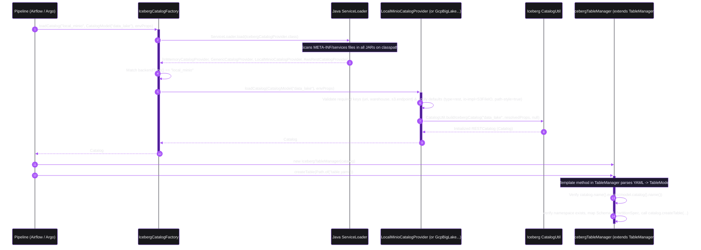

# Spec 02: `lakehouse-iceberg` Core Adapter, Catalog SPI & `lakehouse-iceberg-aws` Plugin

| Field | Value |
| :--- | :--- |
| **Status** | `Approved` |
| **Owner** | Xavier Ruiz |
| **Component** | `lakehouse-iceberg` (Core Adapter) + `lakehouse-iceberg-aws` (AWS / MinIO SPI Plugin) |
| **Stack** | Java 17 · Apache Iceberg `1.7.2` · Java `ServiceLoader` SPI · Maven Shade |
| **Archetype / Tier** | Software Library Contract (Engine Adapter + Plugin SPI) · Full Spec (`19 REQs`, `18 TCs`) |
| **Depends On** | [Spec 00](./00_project_structure_and_organization.md), [Spec 01](./01_lakehouse_core_contracts.md) |

---

## 1. Overview & Design

### TL;DR
Data pipelines (Airflow, Argo, Spark) need one codebase that provisions Iceberg namespaces and tables across local MinIO, AWS REST, and future GCP BigLake catalogs purely via environment configuration—without dragging AWS SDKs into GCP runtime JARs. This spec delivers the cloud-agnostic `lakehouse-iceberg` adapter (`IcebergNamespaceManager`, `IcebergTableManager`, `IcebergTypeMapper`, and `ServiceLoader`-backed `IcebergCatalogFactory` SPI) alongside the isolated `lakehouse-iceberg-aws` plugin (`local_minio` and `aws_rest`). Downstream cloud plugins such as `lakehouse-iceberg-gcp` drop straight onto the classpath with zero changes to core Iceberg managers.

### Architecture

```mermaid
%%{init: {"theme": "base", "themeCSS": "svg { background-color: #09090B !important; border-radius: 8px; }", "themeVariables": {"darkMode": true, "background": "#09090B", "mainBkg": "#18181B", "textColor": "#F4F4F5", "primaryColor": "#18181B", "primaryTextColor": "#F4F4F5", "primaryBorderColor": "#7C3AED", "lineColor": "#A855F7", "secondaryColor": "#16141F", "tertiaryColor": "#0F0F14", "edgeLabelBackground": "#18181B", "clusterBkg": "#0F0F14", "clusterBorder": "#52525B", "titleColor": "#D8B4FE", "fontFamily": "Inter, ui-sans-serif, system-ui, -apple-system, sans-serif", "fontSize": "13px"}, "flowchart": {"curve": "basis", "nodeSpacing": 42, "rankSpacing": 56, "padding": 14}}}%%
flowchart TB
    subgraph Pipeline["1. Unified Platform Pipeline (Airflow / Argo / Spark)"]
        ENV(["Environment Config\nCATALOG_BACKEND · CATALOG_NAME\nuri · warehouse · s3.endpoint"])
        YAML[("User GitOps Files\nnamespace.yaml / table.yaml")]
    end

    subgraph Core["2. lakehouse-core (Engine-Agnostic)"]
        TM["TableManager · abstract\ncreateTable · Path"]
        NM["NamespaceManager · abstract\ncreateNamespace · Path"]
        FM["YamlFileModelManager\nPackage-Private Parser"]
        MOD["Domain Models\nCatalogModel · NamespaceModel\nTableModel"]
    end

    subgraph Iceberg["3. lakehouse-iceberg (Cloud-Agnostic — iceberg-core Only)"]
        FAC["IcebergCatalogFactory\nloadCatalog · backend, CatalogModel, props"]
        SPI["IcebergCatalogProvider · SPI\nbackendType + loadCatalog"]
        BUILTIN["Built-in Providers · META-INF/services\nInMemoryCatalogProvider · in_memory\nGenericCatalogProvider · generic"]
        ITM["IcebergTableManager · Catalog\nExact Catalog Guard + Idempotent DDL"]
        INM["IcebergNamespaceManager · Catalog\nExact Catalog Guard + Idempotent DDL"]
        MAP["IcebergTypeMapper\nPackage-Private Schema/Partition Mapper"]
    end

    subgraph AwsPlugin["4a. lakehouse-iceberg-aws (Local / AWS Jobs Only)"]
        AWS_SPI["META-INF/services\nIcebergCatalogProvider Registry"]
        MINIO["LocalMinioCatalogProvider · local_minio\n+ iceberg-aws · S3FileIO"]
        AWS["AwsRestCatalogProvider · aws_rest\n+ iceberg-aws · S3FileIO"]
    end

    subgraph GcpPlugin["4b. lakehouse-iceberg-gcp (Future Spec 3 — GCP Jobs Only)"]
        GCP_SPI["META-INF/services\nIcebergCatalogProvider Registry"]
        GCP["GcpBigLakeCatalogProvider · gcp_biglake\n+ iceberg-gcp · GCSFileIO"]
    end

    ENV ==>|"backend + props"| FAC
    YAML ==>|"namespace.yaml"| INM
    YAML ==>|"table.yaml"| ITM

    FAC -->|"ServiceLoader scan"| SPI
    BUILTIN -.->|"implements"| SPI
    AWS_SPI -.->|"classpath discovery (AWS JAR)"| SPI
    GCP_SPI -.->|"classpath discovery (GCP JAR)"| SPI
    MINIO -->|"registers"| AWS_SPI
    AWS -->|"registers"| AWS_SPI
    GCP -->|"registers"| GCP_SPI

    FAC ==>|"Catalog instance"| INM
    FAC ==>|"Catalog instance"| ITM

    INM -->|"extends"| NM
    ITM -->|"extends"| TM
    ITM -->|"maps schema"| MAP
    TM -->|"delegates parse"| FM
    NM -->|"delegates parse"| FM
    FM -->|"validates"| MOD

    classDef core fill:#2E1065,stroke:#A855F7,stroke-width:2px,color:#F5F3FF
    classDef service fill:#18181B,stroke:#7C3AED,stroke-width:1.5px,color:#F4F4F5
    classDef store fill:#09090B,stroke:#C084FC,stroke-width:1.5px,color:#EDE9FE
    classDef external fill:#27272A,stroke:#71717A,stroke-width:1.5px,color:#E4E4E7
    classDef async fill:#1E1B2E,stroke:#6B7280,stroke-width:1.25px,stroke-dasharray:4 3,color:#D4D4D8
    classDef guard fill:#3B0764,stroke:#E879F9,stroke-width:2px,stroke-dasharray:5 3,color:#FAF5FF

    class ENV external
    class YAML store
    class FAC,SPI core
    class TM,NM,FM,MOD,ITM,INM,MAP service
    class BUILTIN,MINIO,AWS,GCP async
    class AWS_SPI,GCP_SPI guard

    style Pipeline fill:#18181B,stroke:#52525B,stroke-width:1.25px,stroke-dasharray:5 4,color:#A1A1AA
    style Core fill:#0F0F14,stroke:#52525B,stroke-width:1.5px,color:#D8B4FE
    style Iceberg fill:#16141F,stroke:#6D28D9,stroke-width:1.25px,stroke-dasharray:4 3,color:#C4B5FD
    style AwsPlugin fill:#0F0F14,stroke:#52525B,stroke-width:1.5px,color:#D8B4FE
    style GcpPlugin fill:#0F0F14,stroke:#52525B,stroke-width:1.5px,color:#D8B4FE
```



### Runtime Flow



### Key Design Decisions
- **Cloud-isolated `ServiceLoader` SPI:** Moving AWS/MinIO `FileIO` and catalog providers into `lakehouse-iceberg-aws` keeps `lakehouse-iceberg` strictly on `iceberg-core` so GCP runtimes never inherit AWS SDK JARs.
- **Exact catalog-name guard:** Managers verify `catalog.name().equals(model.catalog().name())` before any Iceberg call, preventing a `prod_lake` YAML from mutating a `dev_lake` catalog.
- **Race-safe idempotency:** Both managers combine existence pre-checks with catching Iceberg's `AlreadyExistsException` (and translating TOCTOU `NoSuchNamespaceException`) for safe concurrent retries.
- **Shade-safe SPI packaging:** `lakehouse-iceberg-aws` enables `ServicesResourceTransformer` in `maven-shade-plugin` so uber-JARs merge `META-INF/services` entries instead of overwriting built-in providers.

### Done Looks Like
- `lakehouse-iceberg` passes `TC-001`–`TC-014` with zero AWS or GCP dependencies (`iceberg-aws` and `iceberg-aws-bundle` removed from `lakehouse-iceberg/pom.xml`).
- `lakehouse-iceberg-aws` passes `TC-015`–`TC-017` offline via `ServiceLoader` and property-resolution unit tests, and provides an opt-in Docker REST + MinIO integration test (`IcebergRestCatalogIT`, `TC-018`).
- Every verification gate below passes with 0 errors and 0 warnings.

| Gate | Command | Scope |
| :--- | :--- | :--- |
| Unit Tests | `mvn clean test` | Full reactor (`lakehouse-core`, `lakehouse-iceberg`, `lakehouse-iceberg-aws`) |
| Strict Javadoc | `mvn javadoc:javadoc -Ddoclint=all` | All new production classes |
| Live MinIO IT (opt-in) | `mvn test -pl lakehouse-iceberg-aws -Dtest=IcebergRestCatalogIT` | Docker REST `:8181` + MinIO `:9000` (`@Tag("integration")`) |

---

## 2. Scope

### In Scope
- Implement cloud-agnostic Iceberg managers (`IcebergNamespaceManager`, `IcebergTableManager`) and package-private `IcebergTypeMapper` in `lakehouse-iceberg` (removing `iceberg-aws` and `iceberg-aws-bundle` from its POM).
- Introduce the `...lakehouse.iceberg.catalog` SPI subsystem (`IcebergCatalogProvider`, `IcebergCatalogFactory`, `InMemoryCatalogProvider`, `GenericCatalogProvider`) registered via `META-INF/services`.
- Create the sibling `lakehouse-iceberg-aws` Maven module (registered in root `pom.xml` with `maven-shade-plugin` `ServicesResourceTransformer`) providing `LocalMinioCatalogProvider` (`"local_minio"`) and `AwsRestCatalogProvider` (`"aws_rest"`).
- Add deterministic unit tests (`*Test`) across both modules plus an opt-in `@Tag("integration")` Docker REST + MinIO test (`IcebergRestCatalogIT`) excluded from normal `mvn clean test`.
- Synchronize `specs/00_project_structure_and_organization.md` to document `lakehouse-<engine>-<cloud>` plugin modules and `...iceberg.catalog`.

### Out of Scope (Non-Goals)
- **No `lakehouse-iceberg-gcp` module yet:** `GcpBigLakeCatalogProvider`, `iceberg-gcp`, and Google ADC/OAuth auth belong to Spec 03.
- **No application-level catalog registry or cached catalog state:** Callers pass one environment-configured `Catalog` instance into each manager and own closing it.
- **No `dropTable`, `tableExists`, `dropNamespace`, `alterTable`, or schema evolution:** Table creation uses strict idempotent `CREATE TABLE IF NOT EXISTS` no-op semantics without schema drift checks.
- **No multi-column partitioning or partition transforms:** Only single identity partition column or `PartitionSpec.unpartitioned()` is supported.
- **No custom table or namespace properties propagation:** `createNamespace` passes empty properties and `createTable` uses catalog defaults.
- **No Spark session or Spark SQL execution:** Managers call the native Apache Iceberg Java Catalog API directly.

---

## 3. Functional Requirements

Exact types, property matrices, defaults, and type mappings live once in **Section 4**.

### Catalog SPI & Factory (`lakehouse-iceberg` — `...iceberg.catalog`)

| ID | What | Why | How |
| :--- | :--- | :--- | :--- |
| `REQ-01` | `IcebergCatalogProvider` SPI interface | Decouples catalog loading from cloud-specific dependencies | `public interface` declaring `backendType()` and `loadCatalog(CatalogModel, Map<String, String>)` |
| `REQ-02` | `IcebergCatalogFactory` static facade | Provides a single stateless entry point and deterministic test hook | `public final class` (private ctor) exposing `loadCatalog(...)`, sorted unmodifiable `availableBackends()`, and package-private `Iterable` test overload |
| `REQ-03` | `ServiceLoader` discovery & validation | Prevents silent misrouting or nondeterministic duplicate backend collisions | Load via `ServiceLoader`, normalize `backendType` (trim + `Locale.ROOT` lowercase), reject null `CatalogModel` (`InvalidCatalogModelException`), and reject blank/duplicate/unknown backends (`CatalogOperationException` listing available backends) |
| `REQ-04` | Built-in `InMemoryCatalogProvider` | Enables fast, zero-Docker unit testing in every downstream module | Backend `"in_memory"` loads `InMemoryCatalog` via `CatalogUtil.buildIcebergCatalog`, defaults `warehouse`, rejects null map entries, and wraps load failures |
| `REQ-05` | Built-in `GenericCatalogProvider` | Supports arbitrary Iceberg catalogs (Polaris, Nessie, Hive, JDBC) without custom plugins | Backend `"generic"` rejects null model or null/empty/null-entry properties, defensively copies properties, and delegates to `CatalogUtil.buildIcebergCatalog` |

### AWS / Local MinIO Plugin (`lakehouse-iceberg-aws` — `...iceberg.aws`)

| ID | What | Why | How |
| :--- | :--- | :--- | :--- |
| `REQ-06` | Isolated `lakehouse-iceberg-aws` module | Keeps AWS SDKs out of `lakehouse-iceberg` and non-AWS runtime JARs | Sibling Maven module depending on `lakehouse-iceberg`, `iceberg-aws`, and `iceberg-aws-bundle`; `lakehouse-iceberg` carries zero AWS deps |
| `REQ-07` | `LocalMinioCatalogProvider` (`local_minio`) | Eliminates repetitive local Docker REST + MinIO S3 boilerplate | Requires non-blank `uri`, `warehouse`, and `s3.endpoint`; applies REST + `S3FileIO` + path-style defaults while preserving caller properties (§4.4) |
| `REQ-08` | `AwsRestCatalogProvider` (`aws_rest`) | Simplifies AWS Iceberg REST + SigV4 configuration with safe defaults | Requires non-blank `uri` and `warehouse`; applies REST + `S3FileIO` defaults and auto-enables SigV4 when `rest.signing-region` is set (§4.4) |
| `REQ-09` | `META-INF/services` & shade safety | Ensures `ServiceLoader` discovers all providers across both standard and shaded JARs | Register providers in both modules' `META-INF/services/...IcebergCatalogProvider` and configure `ServicesResourceTransformer` in `lakehouse-iceberg-aws` |

### Manager Construction & Catalog Identity Guard (`lakehouse-iceberg`)

| ID | What | Why | How |
| :--- | :--- | :--- | :--- |
| `REQ-10` | `IcebergNamespaceManager` & `IcebergTableManager` | Bridges `lakehouse-core` Template-Method contracts onto Iceberg's native `Catalog` API | Both are `public final` subclasses accepting a single `org.apache.iceberg.catalog.Catalog` via constructor |
| `REQ-11` | Fail-fast manager constructor validation | Catches misconfigured or namespace-incapable catalogs before any DDL executes | Reject `null` catalog, null/blank `catalog.name()`, or catalogs not implementing `SupportsNamespaces` with `CatalogOperationException` |
| `REQ-12` | Exact catalog-name identity guard | Prevents cross-environment DDL accidents (e.g., `prod_lake` YAML against `dev_lake`) | Verify `catalog.name().equals(model.catalog().name())` before any Iceberg call; throw `CatalogNotFoundException` carrying `model.catalog()` on mismatch |

### Namespace & Table Management (`lakehouse-iceberg`)

| ID | What | Why | How |
| :--- | :--- | :--- | :--- |
| `REQ-13` | `IcebergNamespaceManager.doNamespaceExists` | Checks namespace presence cleanly against Iceberg `SupportsNamespaces` | Validate catalog identity (`REQ-12`), map to `Namespace.of(model.name())`, and return `supportsNamespaces.namespaceExists(namespace)` |
| `REQ-14` | `IcebergNamespaceManager.doCreateNamespace` | Guarantees idempotent, race-safe namespace provisioning | Validate catalog identity (`REQ-12`), no-op if exists, else call `createNamespace(namespace)` absorbing `AlreadyExistsException` |
| `REQ-15` | `IcebergTableManager.doCreateTable` | Enforces strict parent namespace presence and idempotent table creation | Validate catalog (`REQ-12`), require existing namespace (`NamespaceNotFoundException` if missing), no-op if `tableExists`, else map via `IcebergTypeMapper` and call `catalog.createTable` |
| `REQ-16` | Race-condition & unexpected error mapping | Keeps concurrent DDL safe and translates Iceberg runtime errors to SDK exceptions | Absorb `AlreadyExistsException`, map `NoSuchNamespaceException` to `NamespaceNotFoundException` with cause, and wrap other `RuntimeException` (non-`LakehouseException`) in `CatalogOperationException` |

### Schema, Type, Partition & Identifier Mapping (`IcebergTypeMapper`)

| ID | What | Why | How |
| :--- | :--- | :--- | :--- |
| `REQ-17` | Encapsulated `IcebergTypeMapper` utility | Keeps Iceberg schema/type translation testable without widening public API | Package-private `final class` (private constructor) in `...lakehouse.iceberg` |
| `REQ-18` | Deterministic Iceberg `Schema` translation | Produces reproducible field IDs, nullability, and canonical Iceberg primitive types | Assign sequential 1-based IDs (`1..N`), map `nullable` to `optional`/`required`, and exhaustively switch `ColumnType` (§4.5) |
| `REQ-19` | Partition & identifier translation | Translates domain identity models consistently into Iceberg API objects | Return `PartitionSpec.unpartitioned()` or identity partition spec, `Namespace.of(model.name())`, and `TableIdentifier.of(Namespace, tableName)` |

---

## 4. Contract & Blueprint

### 4.1 Module & Package Layout

```text
sdk_lakehouse/
├── lakehouse-core/                     # Engine-agnostic models, Template-Method managers, YAML parser
├── lakehouse-iceberg/                  # Cloud-agnostic Iceberg adapter (iceberg-core ONLY; zero cloud SDKs)
│   ├── ...lakehouse.iceberg/
│   │   ├── IcebergNamespaceManager     (public final extends NamespaceManager)
│   │   ├── IcebergTableManager         (public final extends TableManager)
│   │   └── IcebergTypeMapper           (package-private final)
│   ├── ...lakehouse.iceberg.catalog/
│   │   ├── IcebergCatalogProvider      (public SPI interface)
│   │   ├── IcebergCatalogFactory       (public final — ServiceLoader discovery)
│   │   ├── InMemoryCatalogProvider     (backend: "in_memory")
│   │   └── GenericCatalogProvider      (backend: "generic")
│   └── src/main/resources/META-INF/services/...IcebergCatalogProvider
├── lakehouse-iceberg-aws/              # Thin AWS / MinIO plugin JAR (lakehouse-iceberg + iceberg-aws + bundle)
│   ├── ...lakehouse.iceberg.aws/
│   │   ├── LocalMinioCatalogProvider   (backend: "local_minio")
│   │   └── AwsRestCatalogProvider      (backend: "aws_rest")
│   ├── src/main/resources/META-INF/services/...IcebergCatalogProvider
│   └── src/test/java/.../aws/IcebergRestCatalogIT  (@Tag("integration"), opt-in Docker REST + MinIO)
└── lakehouse-iceberg-gcp/              # Future Spec 3: Thin GCP BigLake plugin JAR (zero AWS deps)
```

### 4.2 Public & Package-Private Ports (`lakehouse-iceberg`)

| Type | Operation / Constructor | Behavioral Contract |
| :--- | :--- | :--- |
| `IcebergNamespaceManager` (`public final`) | `public IcebergNamespaceManager(Catalog)` | Validates non-null `Catalog`, non-blank `catalog.name()`, and `SupportsNamespaces` (`CatalogOperationException`). |
| `IcebergNamespaceManager` | `protected doCreateNamespace(NamespaceModel)` | Checks exact catalog name (`CatalogNotFoundException`), returns if exists, calls `createNamespace`, absorbs `AlreadyExistsException`, wraps unexpected errors in `CatalogOperationException`. |
| `IcebergNamespaceManager` | `protected doNamespaceExists(NamespaceModel)` | Checks exact catalog name (`CatalogNotFoundException`), delegates to `supportsNamespaces.namespaceExists`, wraps unexpected errors in `CatalogOperationException`. |
| `IcebergTableManager` (`public final`) | `public IcebergTableManager(Catalog)` | Validates non-null `Catalog`, non-blank `catalog.name()`, and `SupportsNamespaces` (`CatalogOperationException`). |
| `IcebergTableManager` | `protected doCreateTable(TableModel)` | Checks exact catalog name (`CatalogNotFoundException`) and namespace existence (`NamespaceNotFoundException`); no-ops on existing table or `AlreadyExistsException`; translates `NoSuchNamespaceException`; wraps other errors in `CatalogOperationException`. |
| `IcebergTypeMapper` *(pkg-private `final`)* | `static toIcebergType(ColumnType)` | Exhaustive switch mapping all 8 canonical `ColumnType` values (§4.5). |
| `IcebergTypeMapper` | `static toIcebergSchema(List<ColumnModel>)` | Assigns 1-based sequential field IDs (`1..N`) with `optional` (`nullable=true`) or `required` (`nullable=false`). |
| `IcebergTypeMapper` | `static toPartitionSpec(Schema, TableModel)` | Returns `PartitionSpec.unpartitioned()` or `PartitionSpec.builderFor(schema).identity(partitionColumn).build()`. |
| `IcebergTypeMapper` | `static toIcebergNamespace(NamespaceModel)` | Returns `Namespace.of(model.name())`. |
| `IcebergTypeMapper` | `static toIcebergTableIdentifier(TableModel)` | Returns `TableIdentifier.of(Namespace.of(model.namespace().name()), model.name())`. |
| `IcebergCatalogProvider` (`public interface`) | `String backendType()` | Returns unique lowercase backend identifier (e.g., `"in_memory"`, `"local_minio"`). |
| `IcebergCatalogProvider` | `Catalog loadCatalog(CatalogModel, Map<String, String>)` | Validates inputs/properties, applies backend defaults, and initializes an Iceberg `Catalog`. |
| `IcebergCatalogFactory` (`public final`) | `static loadCatalog(String, CatalogModel, Map<String, String>)` | Discovers providers via `ServiceLoader`, normalizes backend ID, validates uniqueness/inputs, and invokes matching provider. |
| `IcebergCatalogFactory` | `static availableBackends()` | Returns an unmodifiable sorted `Set<String>` of all discovered `backendType()` IDs. |
| `IcebergCatalogFactory` | `loadCatalog(..., Iterable<IcebergCatalogProvider>)` *(pkg-private)* | Deterministic test seam bypassing classpath `ServiceLoader`. |

### 4.3 Catalog Providers (`lakehouse-iceberg` & `lakehouse-iceberg-aws`)

All providers are `public final class implements IcebergCatalogProvider` with public no-arg constructors; AWS plugin providers expose package-private `resolveProperties(Map<String, String>)` for offline unit testing.

| Provider | Module & Package | Backend ID | Summary Behavior |
| :--- | :--- | :--- | :--- |
| `InMemoryCatalogProvider` | `lakehouse-iceberg` (`...iceberg.catalog`) | `"in_memory"` | Loads `InMemoryCatalog`; defaults `warehouse` to `"memory://warehouse"`; rejects null map entries. |
| `GenericCatalogProvider` | `lakehouse-iceberg` (`...iceberg.catalog`) | `"generic"` | Defensively copies non-empty caller properties directly to `CatalogUtil.buildIcebergCatalog`. |
| `LocalMinioCatalogProvider` | `lakehouse-iceberg-aws` (`...iceberg.aws`) | `"local_minio"` | Validates required REST/S3 keys, applies MinIO path-style defaults, preserves caller credentials/region. |
| `AwsRestCatalogProvider` | `lakehouse-iceberg-aws` (`...iceberg.aws`) | `"aws_rest"` | Validates required REST keys, applies `S3FileIO` and conditional SigV4 defaults, preserves caller properties. |

### 4.4 AWS Plugin Property Resolution (`LocalMinioCatalogProvider` & `AwsRestCatalogProvider`)

| Property Key | `local_minio` | `aws_rest` | Notes |
| :--- | :--- | :--- | :--- |
| `uri` | **Required** (non-blank) | **Required** (non-blank) | Iceberg REST endpoint URL |
| `warehouse` | **Required** (non-blank) | **Required** (non-blank) | S3/MinIO warehouse path |
| `s3.endpoint` | **Required** (non-blank) | Optional (passthrough) | Local MinIO S3 endpoint |
| `type` | Default `"rest"` | Default `"rest"` | Passed to `CatalogUtil.buildIcebergCatalog` |
| `io-impl` | Default `org.apache.iceberg.aws.s3.S3FileIO` | Default `org.apache.iceberg.aws.s3.S3FileIO` | Overridable by caller |
| `s3.path-style-access` | Default `"true"` | Optional (passthrough) | Required for local MinIO bucket routing |
| `rest.sigv4-enabled` | Optional (passthrough) | Default `"true"` iff `rest.signing-region` is set and omitted | Explicit caller value (e.g., `"false"`) wins |

### 4.5 Canonical `ColumnType` → Apache Iceberg `Type` Mapping

| `ColumnType` | Apache Iceberg `org.apache.iceberg.types.Type` | Notes |
| :--- | :--- | :--- |
| `STRING` | `Types.StringType.get()` | UTF-8 string |
| `INT` | `Types.IntegerType.get()` | 32-bit signed integer |
| `BIGINT` | `Types.LongType.get()` | 64-bit signed integer |
| `DOUBLE` | `Types.DoubleType.get()` | 64-bit IEEE 754 float |
| `BOOLEAN` | `Types.BooleanType.get()` | Boolean |
| `DATE` | `Types.DateType.get()` | Calendar date without timezone |
| `TIMESTAMP` | `Types.TimestampType.withZone()` | UTC instant (`timestamptz`), standard for Iceberg/BigQuery/Spark |
| `DECIMAL` | `Types.DecimalType.of(38, 9)` | Default precision 38, scale 9 (BigQuery `NUMERIC`-compatible) |

### 4.6 External Pipeline Configuration Payloads

```properties
# Local Dev Pipeline (backend=local_minio; requires lakehouse-iceberg-aws)
uri=http://localhost:8181
warehouse=s3://warehouse/
s3.endpoint=http://localhost:9000
client.region=us-east-1
s3.access-key-id=admin
s3.secret-access-key=password
```

```properties
# AWS Prod Pipeline (backend=aws_rest; requires lakehouse-iceberg-aws)
uri=https://iceberg-rest.internal.example.com
warehouse=s3://prod-lakehouse-warehouse/
rest.signing-region=us-east-1
rest.signing-name=execute-api
```

```properties
# Unit Test / Sandbox (backend=in_memory; built into lakehouse-iceberg)
warehouse=memory://warehouse
```

---

## 5. Invariants & Failure Modes

### Key Invariants
- **Strict cloud isolation:** `lakehouse-iceberg` has zero AWS or GCP dependencies in `pom.xml` or source; AWS/MinIO dependencies live exclusively in `lakehouse-iceberg-aws`.
- **Zero stored catalog state:** `IcebergCatalogFactory` and all `IcebergCatalogProvider` implementations are stateless; callers own closing `Closeable`/`AutoCloseable` catalogs.
- **Cross-environment safety:** Exact catalog-name matching (`catalog.name().equals(model.catalog().name())`) blocks running a `prod_lake` YAML against a `dev_lake` catalog.
- **No silent parent creation:** Missing catalogs always throw `CatalogNotFoundException`; missing namespaces always throw `NamespaceNotFoundException`.
- **Concurrent idempotency:** Repeated or racing namespace/table creations absorb Iceberg's `AlreadyExistsException` cleanly.
- **No exception swallowing:** Every wrapped `CatalogOperationException` and TOCTOU `NamespaceNotFoundException` preserves the original `Throwable cause`.
- **SPI shade safety:** `lakehouse-iceberg-aws` configures `ServicesResourceTransformer` in `maven-shade-plugin` so shaded JARs merge `META-INF/services` entries cleanly.

### Failure Modes

| Condition | Expected Behavior | Guarantee |
| :--- | :--- | :--- |
| `loadCatalog(null/blank, ...)` or unknown `backendType` | Throws `CatalogOperationException` | Error message lists available discovered backends |
| Duplicate `IcebergCatalogProvider` registrations for same `backendType` | Throws `CatalogOperationException` | Fails fast; prevents nondeterministic provider selection |
| `loadCatalog(..., null, ...)` (`CatalogModel` is `null`) | Throws `InvalidCatalogModelException` | Fails fast before invoking provider |
| Missing/blank required property (`uri`, `warehouse`, `s3.endpoint`) or `null` key/value | Throws `CatalogOperationException` | Descriptive message naming offending key |
| Underlying Iceberg `CatalogUtil.buildIcebergCatalog` failure | Throws `CatalogOperationException` | Preserves underlying cause |
| Manager constructed with `null`, blank-named, or non-`SupportsNamespaces` catalog | Throws `CatalogOperationException` | Fails fast at construction |
| YAML `catalog` name differs from `catalog.name()` | Throws `CatalogNotFoundException` | Carries `model.catalog()`; zero Iceberg calls made |
| Target namespace missing during `createTable(Path)` (pre-check or `NoSuchNamespaceException`) | Throws `NamespaceNotFoundException` | Carries `model.namespace()`; preserves cause on TOCTOU race |
| Target namespace or table already exists (pre-check or `AlreadyExistsException`) | No-op return | Idempotent success; zero mutation |
| Underlying Iceberg REST, S3, or network error | Throws `CatalogOperationException` | Preserves original Iceberg exception cause |

---

## 6. Acceptance & Verification (`TC-*`)

| Case | Scenario | Pass Condition |
| :--- | :--- | :--- |
| `TC-001` (`REQ-01`–`04`) | SPI discovery (`lakehouse-iceberg` alone) | `availableBackends()` returns `["generic", "in_memory"]`; `loadCatalog("in_memory", CatalogModel("data_lake"), Map.of())` returns initialized `InMemoryCatalog` named `"data_lake"` with default warehouse. |
| `TC-002` (`REQ-05`) | `GenericCatalogProvider` passthrough & validation | Valid properties return initialized `Catalog`; `null` model throws `InvalidCatalogModelException`; `null`/empty/null-entry or invalid Iceberg properties throw `CatalogOperationException` preserving cause. |
| `TC-003` (`REQ-02`, `REQ-03`) | Factory unknown, blank & duplicate backend errors | `null`, `"  "`, unknown `"gcp_biglake"`, or duplicate `"in_memory"` providers throw `CatalogOperationException` (listing available backends for unknown); `" IN_MEMORY "` succeeds. |
| `TC-004` (`REQ-10`, `REQ-11`) | Manager constructor validation | Constructing `IcebergNamespaceManager` or `IcebergTableManager` with `null`, blank-named, or non-`SupportsNamespaces` catalog throws `CatalogOperationException`. |
| `TC-005` (`REQ-12`) | Catalog name mismatch guard | Against `InMemoryCatalog` `"dev_lake"`, all four manager operations targeting `"data_lake"` throw `CatalogNotFoundException` carrying `CatalogModel("data_lake")` with zero mutations. |
| `TC-006` (`REQ-13`, `REQ-14`) | `IcebergNamespaceManager` happy path & idempotency | `namespaceExists(Path)` and `namespaceExists(NamespaceModel)` return `false` initially, `createNamespace(Path)` twice succeeds cleanly, and both return `true` afterward. |
| `TC-007` (`REQ-15`) | `IcebergTableManager` missing-namespace rejection | `createTable(Path)` against `"data_lake"` without `"market_data"` throws `NamespaceNotFoundException` carrying `NamespaceModel("data_lake", "market_data")` without auto-creating it. |
| `TC-008` (`REQ-15`, `REQ-18`, `REQ-19`) | Partitioned table creation happy path | Table `market_data.transactions` is created with 3 columns (`date` required `DATE`, `id` required `LONG`, `amount` optional `DECIMAL(38, 9)`), field IDs `1..3`, and identity partition on `date`. |
| `TC-009` (`REQ-15`, `REQ-18`, `REQ-19`) | Unpartitioned table & default nullability | YAML omitting `partitionColumn` and column `nullable` creates a table with `PartitionSpec.unpartitioned()` and an optional Iceberg field. |
| `TC-010` (`REQ-15`) | Repeated `createTable` idempotency | Calling `createTable(tableYaml)` twice against the same catalog succeeds as a no-op without throwing or altering the existing table. |
| `TC-011` (`REQ-17`, `REQ-18`) | `IcebergTypeMapper` exhaustive mapping | All 8 `ColumnType` values map accurately (`TIMESTAMP` → `withZone()`, `DECIMAL` → `(38, 9)`), preserving column order with 1-based field IDs and `required`/`optional` nullability. |
| `TC-012` (`REQ-14`, `REQ-16`) | Concurrent `AlreadyExistsException` idempotency | Stub catalog returning `false` on existence check and throwing `AlreadyExistsException` on create causes both managers to return cleanly. |
| `TC-013` (`REQ-16`) | TOCTOU `NoSuchNamespaceException` & error wrapping | `NoSuchNamespaceException` translates to `NamespaceNotFoundException` preserving cause; arbitrary `RuntimeException` wraps in `CatalogOperationException` preserving cause. |
| `TC-014` (`REQ-06`, `REQ-17`) | Cloud isolation & Javadoc hygiene | Zero `iceberg-aws`/`iceberg-gcp` deps in `lakehouse-iceberg/pom.xml`, `IcebergTypeMapper` is package-private, and `mvn javadoc:javadoc -pl lakehouse-iceberg -Ddoclint=all` exits with 0 errors and 0 warnings. |
| `TC-015` (`REQ-06`, `REQ-09`) | `lakehouse-iceberg-aws` SPI discovery | `IcebergCatalogFactory.availableBackends()` inside `lakehouse-iceberg-aws` tests discovers `["aws_rest", "generic", "in_memory", "local_minio"]`. |
| `TC-016` (`REQ-07`) | `LocalMinioCatalogProvider` property resolution | `resolveProperties` applies `type=rest`, `io-impl=...S3FileIO`, `s3.path-style-access=true`, preserves overrides/credentials, and throws `CatalogOperationException` on missing required keys or null entries. |
| `TC-017` (`REQ-08`) | `AwsRestCatalogProvider` property resolution | `resolveProperties` applies `type=rest`, `io-impl=...S3FileIO`, defaults `rest.sigv4-enabled=true` when `rest.signing-region` is set unless explicitly overridden, and throws `CatalogOperationException` on missing required keys. |
| `TC-018` (`REQ-07`, `REQ-09`) | Opt-in Docker REST + MinIO integration (`IcebergRestCatalogIT`) | Explicitly running `IcebergRestCatalogIT` (`@Tag("integration")`) against local Docker REST `:8181` + MinIO `:9000` creates namespace and partitioned table idempotently via `"local_minio"`; skipped during normal `mvn clean test`. |
