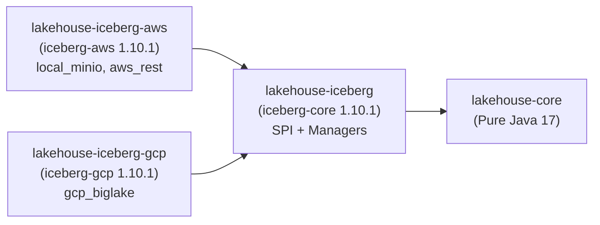

# Feature Spec: `lakehouse-iceberg-gcp` BigLake REST SPI Plugin & Iceberg `1.10.1` Upgrade

- **Status:** Approved
- **Modules / Components:** `lakehouse-iceberg-gcp` (Thin GCP BigLake SPI Plugin) + Centralized Iceberg `1.10.1` Version Property (`parent.iceberg` / `sdk.lakehouse`) — Java 17
- **Archetype:** Software Library Contract (Cloud SPI Plugin)
- **Tier:** Mini-Spec
- **Owner:** Xavier Ruiz
- **Depends On:** `specs/00_project_structure_and_organization.md`, `specs/01_lakehouse_core_contracts.md`, `specs/02_iceberg_catalog_adapter.md`

---

## 1. Goal & Context

### Problem Statement
Spec 2 established a cloud-agnostic `lakehouse-iceberg` adapter (`IcebergTableManager`, `IcebergNamespaceManager`, `IcebergCatalogFactory`, `IcebergCatalogProvider` SPI) and a thin `lakehouse-iceberg-aws` plugin for local Docker MinIO and AWS REST catalogs. To deploy the exact same Airflow/Argo/Spark GitOps pipeline to production on Google Cloud BigLake Iceberg REST without dragging AWS SDKs into GCP runtime JARs, we need a sibling `lakehouse-iceberg-gcp` plugin module backed by `iceberg-gcp` (`GCSFileIO` + native `GoogleAuthManager`). Because `org.apache.iceberg.gcp.auth.GoogleAuthManager` was introduced in Apache Iceberg **`1.10.0`** (not present in `1.7.2` or `1.9.x`), this spec also upgrades the centralized `<iceberg.version>` property to **`1.10.1`** cleanly via Maven's parent/child property inheritance so all modules stay version-aligned from a single XML tag.

### Success Metrics
- All 4 Maven modules (`lakehouse-core`, `lakehouse-iceberg`, `lakehouse-iceberg-aws`, `lakehouse-iceberg-gcp`) compile and pass all unit tests (`mvn clean test`) on Java 17 and Apache Iceberg `1.10.1` with zero GCP credentials or Docker required.
- `lakehouse-iceberg-gcp` discovers `"gcp_biglake"`, `"generic"`, and `"in_memory"` via `ServiceLoader` and contains **zero** AWS SDK / `iceberg-aws` dependencies.
- All acceptance cases (`TC-001` through `TC-010`) pass, including strict Javadoc validation (`mvn test javadoc:javadoc -Ddoclint=all`) with 0 errors and 0 warnings.
- An opt-in live BigLake integration test (`BigLakeRestCatalogIT`, `@Tag("integration")`) is ready for manual GCP verification without impacting normal `mvn clean test`.

---

## 2. Scope & Explicit Non-Goals

### In Scope
- **Centralized Iceberg `1.10.1` version management:**
  - Upgrade Iceberg to `1.10.1` via the single `<iceberg.version>` property (designed to inherit cleanly from `parent.iceberg` once bumped/installed, with single-tag property control in `sdk_lakehouse/pom.xml`).
  - Add `lakehouse-iceberg-gcp`, `iceberg-gcp`, and `iceberg-gcp-bundle` to `<dependencyManagement>` in `sdk_lakehouse/pom.xml` referencing `${iceberg.version}` (and register `<module>lakehouse-iceberg-gcp</module>`).
- **Thin `lakehouse-iceberg-gcp` SPI plugin module:**
  - Depends on `lakehouse-iceberg`, `iceberg-gcp`, `iceberg-gcp-bundle`, Log4j2, JUnit 5, and AssertJ (zero `iceberg-aws` dependencies).
  - Configures `maven-shade-plugin` with `ServicesResourceTransformer` so GCP shaded fat JARs merge `META-INF/services` cleanly.
  - Package `x.ruiz.playground.data.engineering.lakehouse.iceberg.gcp`:
    - `GcpBigLakeCatalogProvider` (`public final class implements IcebergCatalogProvider`, backend `"gcp_biglake"`).
  - `META-INF/services/x.ruiz.playground.data.engineering.lakehouse.iceberg.catalog.IcebergCatalogProvider` registering `GcpBigLakeCatalogProvider`.
- Deterministic unit tests (`GcpBigLakeCatalogProviderTest`) plus opt-in live BigLake integration test (`BigLakeRestCatalogIT`, `@Tag("integration")`) and YAML test fixtures.
- Synchronization of `specs/00_project_structure_and_organization.md` to document `lakehouse-iceberg-gcp` and updated Iceberg version baseline.

### Non-Goals (Do Not Implement)
- **No modifications to `lakehouse-core`, `IcebergTableManager`, `IcebergNamespaceManager`, or `IcebergTypeMapper`:** Existing managers work unchanged against BigLake's `RESTCatalog`—the entire point of the SPI plugin architecture.
- **No custom GCP OAuth token HTTP client code:** Delegates authentication and automatic token renewal to Iceberg `1.10.1`'s native `org.apache.iceberg.gcp.auth.GoogleAuthManager` (which uses Google Application Default Credentials or explicit `gcp.auth.credentials-path`).
- **No GCP infrastructure provisioning (Terraform / `gcloud`):** BigLake catalogs, GCS buckets, and IAM roles remain platform-provisioned outside the SDK.
- **No BigQuery Metastore legacy Thrift/Hadoop catalog:** Strictly Apache Iceberg REST Catalog (`https://biglake.googleapis.com/iceberg/v1/restcatalog`).

---

## 3. Functional Requirements

### Iceberg Version Upgrade & Maven Configuration
- `REQ-01`: The Iceberg dependency version across `sdk_lakehouse` shall be upgraded from `1.7.2` to **`1.10.1`** via the single `<iceberg.version>` Maven property (supporting clean inheritance from `parent.iceberg` and single-tag override in `sdk_lakehouse/pom.xml` without hardcoding version strings in child module POMs).
- `REQ-02`: `sdk_lakehouse/pom.xml` shall declare `lakehouse-iceberg-gcp` in `<modules>` and manage `lakehouse-iceberg-gcp`, `iceberg-gcp`, and `iceberg-gcp-bundle` in `<dependencyManagement>` using `${project.version}` / `${iceberg.version}`.
- `REQ-03`: `lakehouse-iceberg-gcp/pom.xml` shall depend on `lakehouse-iceberg`, `iceberg-gcp`, and `iceberg-gcp-bundle`, shall have **zero** dependency on `lakehouse-iceberg-aws`, `iceberg-aws`, or `iceberg-aws-bundle`, and shall configure `maven-shade-plugin` with `ServicesResourceTransformer`.

### `GcpBigLakeCatalogProvider` (`...lakehouse.iceberg.gcp`)
- `REQ-04`: `GcpBigLakeCatalogProvider` shall be a `public final class` implementing `IcebergCatalogProvider` with a `public` no-arg constructor and `backendType()` returning `"gcp_biglake"`, registered via `src/main/resources/META-INF/services/x.ruiz.playground.data.engineering.lakehouse.iceberg.catalog.IcebergCatalogProvider`.
- `REQ-05`: `GcpBigLakeCatalogProvider.loadCatalog(CatalogModel, Map<String, String>)` shall reject a `null` `CatalogModel` with `InvalidCatalogModelException`, reject a `null`/empty `properties` map or `null` keys/values with `CatalogOperationException`, validate and normalize properties via a package-private `resolveProperties(Map<String, String>)` helper, and load the catalog via `CatalogUtil.buildIcebergCatalog(catalogModel.name(), resolvedProps, null)`, wrapping any Iceberg/auth failure in `CatalogOperationException` preserving cause.
- `REQ-06`: `resolveProperties(Map<String, String>)` shall require:
  - Non-blank `warehouse` (e.g., `gs://<bucket>/...` or BigLake warehouse path).
  - Non-blank GCP billing/routing project ID supplied via **either** `header.x-goog-user-project` **or** convenience key `gcp.project`. When `gcp.project` is provided, it shall be mapped to `header.x-goog-user-project` and `gcp.project` removed from the map handed to Iceberg. If both keys are provided with different values (after trimming), it shall fail fast with `CatalogOperationException`.
- `REQ-07`: `resolveProperties(Map<String, String>)` shall enforce and apply the following BigLake REST defaults without clobbering explicit caller overrides (except enforcing `type=rest` and stripping `catalog-impl`):
  - `type` → `"rest"` (enforced)
  - `uri` → `"https://biglake.googleapis.com/iceberg/v1/restcatalog"` (default if omitted)
  - `io-impl` → `"org.apache.iceberg.gcp.gcs.GCSFileIO"` (default if omitted)
  - `rest.auth.type` → `"org.apache.iceberg.gcp.auth.GoogleAuthManager"` (default if omitted)
  - `header.X-Iceberg-Access-Delegation` → `"vended-credentials"` (default if omitted)
- `REQ-08`: All additional caller properties (such as `gcp.auth.credentials-path`, `gcp.auth.scopes`, `gcs.project-id`, or custom `header.*` values) shall be preserved verbatim into the resolved Iceberg property map.

### Compatibility & Spec Synchronization
- `REQ-09`: Upgrading to Iceberg `1.10.1` shall preserve 100% compatibility across all existing `lakehouse-core`, `lakehouse-iceberg`, and `lakehouse-iceberg-aws` unit tests (and live Docker `IcebergRestCatalogIT`).
- `REQ-10`: `specs/00_project_structure_and_organization.md` shall be updated to reflect `lakehouse-iceberg-gcp` in the repository layout.

---

## 4. Public Java API & Module Contract

### Multi-Module Cloud Isolation Overview



### Public Type (`x.ruiz.playground.data.engineering.lakehouse.iceberg.gcp`)

| Type | Kind & Visibility | Constants / Constructors | Methods | Contract |
| :--- | :--- | :--- | :--- | :--- |
| `GcpBigLakeCatalogProvider` | `public final class implements IcebergCatalogProvider` | `public static final String BACKEND_TYPE = "gcp_biglake"`<br/>`public static final String DEFAULT_BIGLAKE_URI = "https://biglake.googleapis.com/iceberg/v1/restcatalog"`<br/>`public GcpBigLakeCatalogProvider()` | `backendType()` → `"gcp_biglake"`<br/>`loadCatalog(CatalogModel, Map<String, String>)` → `Catalog`<br/>*(package-private)* `resolveProperties(Map<String, String>)` → `Map<String, String>` | Stateless SPI provider validating `warehouse` + GCP project (`gcp.project` or `header.x-goog-user-project`), applying BigLake REST + `GCSFileIO` + `GoogleAuthManager` + `vended-credentials` defaults, and loading via `CatalogUtil.buildIcebergCatalog`. |

### Property Resolution Matrix (`GcpBigLakeCatalogProvider`)

| Property Key | Requirement | Default Value | Notes |
| :--- | :--- | :--- | :--- |
| `warehouse` | **Required** (non-blank) | — | GCS bucket/prefix (`gs://...`) or BigLake warehouse path |
| `gcp.project` *or* `header.x-goog-user-project` | **Required** (at least one non-blank) | — | `gcp.project` is translated to `header.x-goog-user-project` and stripped; conflicting values throw `CatalogOperationException` |
| `type` | Enforced | `"rest"` | Always set to `"rest"`; removes `catalog-impl` if passed |
| `uri` | Optional | `"https://biglake.googleapis.com/iceberg/v1/restcatalog"` | Overridable for regional, staging, or mock REST endpoints |
| `io-impl` | Optional | `"org.apache.iceberg.gcp.gcs.GCSFileIO"` | Overridable by caller |
| `rest.auth.type` | Optional | `"org.apache.iceberg.gcp.auth.GoogleAuthManager"` | Uses Google ADC by default; supports `gcp.auth.credentials-path` and `gcp.auth.scopes` |
| `header.X-Iceberg-Access-Delegation` | Optional | `"vended-credentials"` | Overridable by caller |

### Environment-Driven Pipeline Configuration Example (External Config Only)

**Production GCP BigLake Pipeline (`CATALOG_BACKEND=gcp_biglake`, requires `lakehouse-iceberg-gcp` on classpath):**
```properties
warehouse=gs://my-lakehouse-warehouse/
gcp.project=my-gcp-project-id
```

**Optional explicit credentials & custom scopes:**
```properties
warehouse=gs://my-lakehouse-warehouse/
header.x-goog-user-project=my-gcp-project-id
gcp.auth.credentials-path=/var/secrets/google/key.json
gcp.auth.scopes=https://www.googleapis.com/auth/cloud-platform
```

---

## 5. Invariants, Edge Cases & Failure Modes

### Key Invariants
1. **Strict Cloud Isolation:** `lakehouse-iceberg-gcp` has zero `iceberg-aws` / AWS SDK dependencies; `lakehouse-iceberg-aws` has zero `iceberg-gcp` / Google Cloud SDK dependencies; `lakehouse-iceberg` has neither.
2. **Single Version Source of Truth:** All Iceberg artifacts (`iceberg-api`, `iceberg-core`, `iceberg-aws`, `iceberg-aws-bundle`, `iceberg-gcp`, `iceberg-gcp-bundle`) resolve from `${iceberg.version}` (`1.10.1`)—never mixed Iceberg versions across modules.
3. **Stateless Provider:** `GcpBigLakeCatalogProvider` holds no mutable state or credential caches; callers own closing returned `AutoCloseable` catalogs.
4. **No Leaked Shorthand Keys:** `gcp.project` is consumed and translated into `header.x-goog-user-project` before invoking `CatalogUtil.buildIcebergCatalog`.
5. **Shaded Fat JAR Safety:** `ServicesResourceTransformer` in `lakehouse-iceberg-gcp/pom.xml` preserves `META-INF/services/...IcebergCatalogProvider` entries from both `lakehouse-iceberg` and `lakehouse-iceberg-gcp`.

### Failure Mode Matrix

| Failure Condition | Expected Exception | Notes |
| :--- | :--- | :--- |
| `loadCatalog(null, props)` | `InvalidCatalogModelException` | Fail fast before property resolution |
| `properties` is `null`, empty, or contains `null` key/value | `CatalogOperationException` | Descriptive message; never leaks `NullPointerException` |
| Missing or blank `warehouse` | `CatalogOperationException` | Message names `warehouse` |
| Neither `gcp.project` nor `header.x-goog-user-project` is provided/non-blank | `CatalogOperationException` | Message names both accepted keys |
| Both `gcp.project` and `header.x-goog-user-project` provided with conflicting values | `CatalogOperationException` | Prevents ambiguous billing/routing project attribution |
| Missing Google ADC / unreachable BigLake REST URI / `403` during `CatalogUtil.buildIcebergCatalog` | `CatalogOperationException` | Preserves underlying Iceberg / Google Auth cause |

---

## 6. Acceptance Criteria & Verification Matrix

| Case ID | Scenario | Input / Precondition | Expected Outcome |
| :--- | :--- | :--- | :--- |
| `TC-001` | `lakehouse-iceberg-gcp` SPI discovery & AWS isolation | Call `IcebergCatalogFactory.availableBackends()` inside `lakehouse-iceberg-gcp` tests | Returns `["gcp_biglake", "generic", "in_memory"]` (proving `"local_minio"` and `"aws_rest"` are NOT present on the GCP classpath). |
| `TC-002` | `GcpBigLakeCatalogProvider` defaults with `gcp.project` shorthand | `resolveProperties(Map.of("warehouse", "gs://my-bucket/", "gcp.project", "my-proj"))` | Sets `type=rest`, `uri=https://biglake.googleapis.com/iceberg/v1/restcatalog`, `io-impl=...GCSFileIO`, `rest.auth.type=...GoogleAuthManager`, `header.X-Iceberg-Access-Delegation=vended-credentials`, `header.x-goog-user-project=my-proj`, and removes `gcp.project`. |
| `TC-003` | Explicit `header.x-goog-user-project` & caller overrides | Supply `header.x-goog-user-project`, custom `uri`, custom `rest.auth.type`, custom `header.X-Iceberg-Access-Delegation`, `gcp.auth.credentials-path`, and matching `gcp.project` | Caller overrides and extra auth properties are preserved; `type` remains `"rest"` and `catalog-impl` is stripped if present. |
| `TC-004` | Input & property validation errors | `null` `CatalogModel`, `null`/empty/null-entry map, missing `warehouse`, missing project ID, or conflicting `gcp.project` vs. `header.x-goog-user-project` | Throws `InvalidCatalogModelException` (for null model) or `CatalogOperationException` with clear diagnostic messages naming offending keys. |
| `TC-005` | Underlying catalog/auth error wrapping | Call `loadCatalog(CatalogModel("data_lake"), props)` pointing at an unreachable local port (e.g., `http://127.0.0.1:1`) with `rest.auth.type=none` | Wraps Iceberg connection failure in `CatalogOperationException` preserving the original cause. |
| `TC-006` | Iceberg `1.10.1` full reactor regression | Run `mvn clean test` across all 4 modules (`lakehouse-core`, `lakehouse-iceberg`, `lakehouse-iceberg-aws`, `lakehouse-iceberg-gcp`) | All existing + new unit tests pass on Java 17 & Iceberg `1.10.1` with 0 failures and 0 errors. |
| `TC-007` | Live Docker MinIO REST regression on Iceberg `1.10.1` | Run `IcebergRestCatalogIT` against local Docker `iceberg-rest` + MinIO | Passes cleanly on Iceberg `1.10.1` (confirming no REST regressions from `1.7.2` → `1.10.1`). |
| `TC-008` | Strict cloud dependency isolation | Audit `lakehouse-iceberg/pom.xml`, `lakehouse-iceberg-aws/pom.xml`, and `lakehouse-iceberg-gcp/pom.xml` | Zero AWS deps in `lakehouse-iceberg` or `lakehouse-iceberg-gcp`; zero GCP deps in `lakehouse-iceberg` or `lakehouse-iceberg-aws`; all Iceberg versions resolved from `${iceberg.version}`. |
| `TC-009` | Strict Javadoc lint across all modules | Run `mvn test javadoc:javadoc -Ddoclint=all` | Succeeds across all 4 modules with 0 errors and 0 warnings. |
| `TC-010` | Opt-in live GCP BigLake integration test (`BigLakeRestCatalogIT`, `@Tag("integration")`) | Run explicitly via `mvn test -pl lakehouse-iceberg-gcp -am -Dtest=BigLakeRestCatalogIT -Dsurefire.failIfNoSpecifiedTests=false -Dbiglake.warehouse=gs://... -Dbiglake.project=...` with active GCP ADC | Loads live BigLake `RESTCatalog` via `IcebergCatalogFactory.loadCatalog("gcp_biglake", ...)`, creates namespace + partitioned table from YAML fixtures idempotently, and verifies metadata; skipped during normal `mvn clean test`. |
