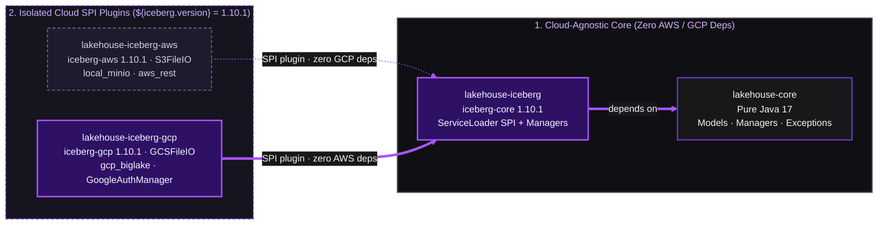

# Spec 03: `lakehouse-iceberg-gcp` BigLake REST SPI Plugin & Iceberg `1.10.1` Upgrade

| Field | Value |
| :--- | :--- |
| **Status** | `Approved` |
| **Owner** | Xavier Ruiz |
| **Component** | `lakehouse-iceberg-gcp` (Thin GCP BigLake SPI Plugin) + Centralized `<iceberg.version>` (`1.10.1`) |
| **Stack** | Java 17 · Apache Iceberg `1.10.1` · `iceberg-gcp` · `GoogleAuthManager` · Maven Shade |
| **Archetype / Tier** | Software Library Contract (Cloud SPI Plugin) · Mini-Spec (`10 REQs`, `10 TCs`) |
| **Depends On** | [Spec 00](./00_project_structure_and_organization.md), [Spec 01](./01_lakehouse_core_contracts.md), [Spec 02](./02_iceberg_catalog_adapter.md) |

---

## 1. Overview & Design

### TL;DR
Deploying the unified GitOps lakehouse pipeline onto Google Cloud BigLake Iceberg REST requires a cloud-isolated `lakehouse-iceberg-gcp` SPI plugin backed by `GCSFileIO` and Iceberg's native `GoogleAuthManager`—without dragging AWS SDKs into GCP runtime JARs. Because `org.apache.iceberg.gcp.auth.GoogleAuthManager` was introduced in Apache Iceberg `1.10.0`, this spec upgrades the single centralized `<iceberg.version>` property to `1.10.1` across the reactor and delivers the `"gcp_biglake"` provider. Existing `IcebergNamespaceManager` and `IcebergTableManager` code works unchanged against BigLake REST.

### Architecture



### Key Design Decisions
- **Native `GoogleAuthManager` over custom OAuth code:** Upgrading `<iceberg.version>` to `1.10.1` lets BigLake REST reuse Iceberg's built-in ADC/credentials-path token renewal with zero hand-rolled OAuth HTTP clients.
- **Single-tag Iceberg version alignment:** Resolving all Iceberg modules from `${iceberg.version}` (inheritable from `parent.iceberg` or controlled once in `sdk_lakehouse/pom.xml`) eliminates mixed-version classpath conflicts.
- **Shorthand project translation with conflict guard:** Accepting either `gcp.project` or `header.x-goog-user-project` simplifies pipeline config while stripping `gcp.project` and rejecting conflicting values fail-fast.
- **Zero changes to core Iceberg managers:** Validating that `IcebergTableManager` and `IcebergNamespaceManager` work unmodified against BigLake confirms the SPI plugin boundary.

### Done Looks Like
- All four Maven modules (`lakehouse-core`, `lakehouse-iceberg`, `lakehouse-iceberg-aws`, `lakehouse-iceberg-gcp`) pass unit tests on Java 17 and Iceberg `1.10.1` with zero GCP credentials or Docker required.
- `lakehouse-iceberg-gcp` discovers `["gcp_biglake", "generic", "in_memory"]` via `ServiceLoader` and carries zero AWS SDK dependencies.
- All verification gates below and acceptance cases `TC-001` through `TC-010` pass cleanly.

| Gate | Command | Scope |
| :--- | :--- | :--- |
| Full Reactor Unit Tests | `mvn clean test` | All 4 modules on Java 17 & Iceberg `1.10.1` |
| Strict Javadoc | `mvn test javadoc:javadoc -Ddoclint=all` | All 4 modules (0 errors, 0 warnings) |
| Live BigLake IT (opt-in) | `mvn test -pl lakehouse-iceberg-gcp -am -Dtest=BigLakeRestCatalogIT -Dsurefire.failIfNoSpecifiedTests=false -Dbiglake.warehouse=... -Dbiglake.project=...` | Live GCP BigLake with ADC (`@Tag("integration")`) |

---

## 2. Scope

### In Scope
- Upgrade centralized `<iceberg.version>` from `1.7.2` to `1.10.1` via Maven property inheritance (`parent.iceberg` / `sdk_lakehouse/pom.xml`) and manage `lakehouse-iceberg-gcp`, `iceberg-gcp`, and `iceberg-gcp-bundle` in `<dependencyManagement>`.
- Add the thin `lakehouse-iceberg-gcp` Maven module depending on `lakehouse-iceberg`, `iceberg-gcp`, `iceberg-gcp-bundle`, Log4j2, JUnit 5, and AssertJ (zero AWS deps) with `maven-shade-plugin` `ServicesResourceTransformer`.
- Implement `GcpBigLakeCatalogProvider` (`"gcp_biglake"`) in `x.ruiz.playground.data.engineering.lakehouse.iceberg.gcp` and register it in `META-INF/services/...IcebergCatalogProvider`.
- Add deterministic unit tests (`GcpBigLakeCatalogProviderTest`), YAML fixtures, and an opt-in live BigLake integration test (`BigLakeRestCatalogIT`, `@Tag("integration")`).
- Synchronize `specs/00_project_structure_and_organization.md` to document `lakehouse-iceberg-gcp` and the updated Iceberg version baseline.

### Out of Scope (Non-Goals)
- **No modifications to `lakehouse-core` or core Iceberg managers:** `IcebergTableManager`, `IcebergNamespaceManager`, and `IcebergTypeMapper` work unchanged against BigLake REST.
- **No custom GCP OAuth HTTP client code:** Authentication and token refresh delegate strictly to Iceberg `1.10.1`'s native `org.apache.iceberg.gcp.auth.GoogleAuthManager`.
- **No GCP infrastructure provisioning (Terraform / `gcloud`):** BigLake catalogs, GCS buckets, and IAM roles remain platform-provisioned outside the SDK.
- **No BigQuery Metastore legacy Thrift/Hadoop catalog:** Strictly Apache Iceberg REST Catalog (`https://biglake.googleapis.com/iceberg/v1/restcatalog`).

---

## 3. Functional Requirements

Exact constants, method signatures, and property defaults live once in **Section 4**.

### Iceberg Version Upgrade & Maven Configuration

| ID | What | Why | How |
| :--- | :--- | :--- | :--- |
| `REQ-01` | Centralized Iceberg `1.10.1` upgrade | Unlocks `GoogleAuthManager` (added in `1.10.0`) while preventing cross-module version drift | Bump `<iceberg.version>` from `1.7.2` to `1.10.1` once in parent/reactor POM without hardcoding versions in child POMs |
| `REQ-02` | Reactor registration & dependency management | Keeps module versions and GCP Iceberg coordinates centrally governed | Register `lakehouse-iceberg-gcp` in `<modules>` and manage `lakehouse-iceberg-gcp`, `iceberg-gcp`, and `iceberg-gcp-bundle` via `${project.version}` / `${iceberg.version}` |
| `REQ-03` | Cloud-isolated `lakehouse-iceberg-gcp` POM | Guarantees lean GCP runtime fat JARs with safe SPI merging | Depend on `lakehouse-iceberg`, `iceberg-gcp`, and `iceberg-gcp-bundle` with zero AWS deps, and configure `ServicesResourceTransformer` in `maven-shade-plugin` |

### `GcpBigLakeCatalogProvider` (`...lakehouse.iceberg.gcp`)

| ID | What | Why | How |
| :--- | :--- | :--- | :--- |
| `REQ-04` | SPI provider class & registration | Allows `IcebergCatalogFactory` to auto-discover BigLake when the GCP JAR is on the classpath | `public final class GcpBigLakeCatalogProvider implements IcebergCatalogProvider` with no-arg ctor, `"gcp_biglake"` ID, and `META-INF/services` entry |
| `REQ-05` | Fail-fast loading & error wrapping | Prevents `NullPointerException` leaks and wraps Iceberg/auth failures consistently | Reject `null` `CatalogModel` (`InvalidCatalogModelException`), reject null/empty/null-entry properties (`CatalogOperationException`), resolve via `resolveProperties`, and load via `CatalogUtil.buildIcebergCatalog` |
| `REQ-06` | Required warehouse & GCP project resolution | Ensures BigLake billing/routing header and storage root are always unambiguous | Require non-blank `warehouse` and at least one of `gcp.project` or `header.x-goog-user-project`; map & strip `gcp.project`; reject conflicting values (`CatalogOperationException`) |
| `REQ-07` | BigLake REST defaults & enforcement | Provides zero-boilerplate BigLake REST + ADC + vended-credentials setup while honoring overrides | Enforce `type=rest` (stripping `catalog-impl`) and default `uri`, `io-impl`, `rest.auth.type`, and `header.X-Iceberg-Access-Delegation` (§4.3) |
| `REQ-08` | Caller property passthrough | Lets pipelines configure custom credential paths, OAuth scopes, or GCS options freely | Preserve all additional caller properties (`gcp.auth.credentials-path`, `gcp.auth.scopes`, `gcs.project-id`, custom `header.*`) verbatim |

### Compatibility & Spec Synchronization

| ID | What | Why | How |
| :--- | :--- | :--- | :--- |
| `REQ-09` | Zero regression across existing modules | Confirms Iceberg `1.10.1` breaks neither core/AWS unit tests nor live Docker MinIO REST | Pass all existing `lakehouse-core`, `lakehouse-iceberg`, and `lakehouse-iceberg-aws` unit tests plus live Docker `IcebergRestCatalogIT` |
| `REQ-10` | Architecture spec synchronization | Keeps repository structural docs accurate after adding the GCP plugin module | Update `specs/00_project_structure_and_organization.md` to include `lakehouse-iceberg-gcp` |

---

## 4. Contract & Blueprint

### 4.1 Module & Package Layout

```text
sdk_lakehouse/lakehouse-iceberg-gcp/
├── pom.xml                                                      # lakehouse-iceberg + iceberg-gcp + iceberg-gcp-bundle + shade transformer
└── src/
    ├── main/
    │   ├── java/x/ruiz/playground/data/engineering/lakehouse/iceberg/gcp/
    │   │   └── GcpBigLakeCatalogProvider.java                   # public final implements IcebergCatalogProvider
    │   └── resources/META-INF/services/
    │       └── x.ruiz.playground.data.engineering.lakehouse.iceberg.catalog.IcebergCatalogProvider
    └── test/
        ├── java/x/ruiz/playground/data/engineering/lakehouse/iceberg/gcp/
        │   ├── GcpBigLakeCatalogProviderTest.java               # Offline unit & SPI discovery tests
        │   └── BigLakeRestCatalogIT.java                        # Opt-in live GCP BigLake test (@Tag("integration"))
        └── resources/                                           # YAML test fixtures
```

### 4.2 Public Interface & Members (`GcpBigLakeCatalogProvider`)

Package: `x.ruiz.playground.data.engineering.lakehouse.iceberg.gcp` (`public final class implements IcebergCatalogProvider`).

| Member | Visibility / Kind | Behavioral Contract |
| :--- | :--- | :--- |
| `BACKEND_TYPE` | `public static final String` | Constant value `"gcp_biglake"`. |
| `DEFAULT_BIGLAKE_URI` | `public static final String` | Constant value `"https://biglake.googleapis.com/iceberg/v1/restcatalog"`. |
| `GcpBigLakeCatalogProvider()` | `public` constructor | Stateless no-arg constructor required by Java `ServiceLoader`. |
| `backendType()` | `public String` | Returns `BACKEND_TYPE` (`"gcp_biglake"`). |
| `loadCatalog(CatalogModel, Map<String, String>)` | `public Catalog` | Rejects `null` model (`InvalidCatalogModelException`), calls `resolveProperties`, and invokes `CatalogUtil.buildIcebergCatalog(model.name(), resolvedProps, null)` wrapping failures in `CatalogOperationException`. |
| `resolveProperties(Map<String, String>)` | Package-private `Map<String, String>` | Validates required keys, resolves `gcp.project`, enforces `type=rest`, applies BigLake defaults, and preserves extra caller properties for offline unit testing. |

### 4.3 Property Resolution Matrix (`GcpBigLakeCatalogProvider`)

| Property Key | Requirement | Default Value | Notes |
| :--- | :--- | :--- | :--- |
| `warehouse` | **Required** (non-blank) | — | GCS bucket/prefix (`gs://...`) or BigLake warehouse path (`bl://...`) |
| `gcp.project` | **Required** *(unless `header.x-goog-user-project` set)* | — | Translated to `header.x-goog-user-project` and stripped; conflicting value throws `CatalogOperationException` |
| `header.x-goog-user-project` | **Required** *(unless `gcp.project` set)* | — | Native GCP billing/routing header; must match trimmed `gcp.project` if both supplied |
| `type` | **Enforced** | `"rest"` | Always forced to `"rest"`; strips `catalog-impl` if present |
| `uri` | Optional | `"https://biglake.googleapis.com/iceberg/v1/restcatalog"` | Overridable for regional, staging, or mock REST endpoints |
| `io-impl` | Optional | `"org.apache.iceberg.gcp.gcs.GCSFileIO"` | Overridable by caller |
| `rest.auth.type` | Optional | `"org.apache.iceberg.gcp.auth.GoogleAuthManager"` | Uses Google ADC by default; supports `gcp.auth.credentials-path` and `gcp.auth.scopes` |
| `header.X-Iceberg-Access-Delegation` | Optional | `"vended-credentials"` | Overridable by caller |

### 4.4 External Pipeline Configuration Payloads

```properties
# Production GCP BigLake Pipeline (CATALOG_BACKEND=gcp_biglake; requires lakehouse-iceberg-gcp)
warehouse=gs://my-lakehouse-warehouse/
gcp.project=my-gcp-project-id
```

```properties
# Explicit credentials & custom scopes
warehouse=gs://my-lakehouse-warehouse/
header.x-goog-user-project=my-gcp-project-id
gcp.auth.credentials-path=/var/secrets/google/key.json
gcp.auth.scopes=https://www.googleapis.com/auth/cloud-platform
```

---

## 5. Invariants & Failure Modes

### Key Invariants
- **Strict cloud isolation:** `lakehouse-iceberg-gcp` has zero `iceberg-aws`/AWS SDK deps, `lakehouse-iceberg-aws` has zero `iceberg-gcp`/GCP SDK deps, and `lakehouse-iceberg` has neither.
- **Single version source of truth:** All Iceberg artifacts (`iceberg-api`, `iceberg-core`, `iceberg-aws`, `iceberg-aws-bundle`, `iceberg-gcp`, `iceberg-gcp-bundle`) resolve from `${iceberg.version}` (`1.10.1`) with zero mixed versions.
- **Stateless provider:** `GcpBigLakeCatalogProvider` holds no mutable state or credential caches; callers own closing returned `AutoCloseable` catalogs.
- **No leaked shorthand keys:** `gcp.project` is translated to `header.x-goog-user-project` and removed before invoking `CatalogUtil.buildIcebergCatalog`.
- **Shaded fat JAR safety:** `ServicesResourceTransformer` in `lakehouse-iceberg-gcp/pom.xml` merges `META-INF/services/...IcebergCatalogProvider` entries from both `lakehouse-iceberg` and `lakehouse-iceberg-gcp`.

### Failure Modes

| Condition | Expected Behavior | Guarantee |
| :--- | :--- | :--- |
| `loadCatalog(null, props)` | Throws `InvalidCatalogModelException` | Fails fast before property resolution |
| `properties` is `null`, empty, or contains `null` key/value | Throws `CatalogOperationException` | Descriptive message; never leaks `NullPointerException` |
| Missing or blank `warehouse` | Throws `CatalogOperationException` | Error message names `warehouse` |
| Neither `gcp.project` nor `header.x-goog-user-project` provided/non-blank | Throws `CatalogOperationException` | Error message names both accepted keys |
| Both `gcp.project` and `header.x-goog-user-project` provided with differing trimmed values | Throws `CatalogOperationException` | Prevents ambiguous billing/routing project attribution |
| Missing Google ADC, unreachable BigLake URI, or `403` during `CatalogUtil.buildIcebergCatalog` | Throws `CatalogOperationException` | Preserves underlying Iceberg / Google Auth cause |

---

## 6. Acceptance & Verification (`TC-*`)

| Case | Scenario | Pass Condition |
| :--- | :--- | :--- |
| `TC-001` (`REQ-03`, `REQ-04`) | SPI discovery & AWS isolation | `IcebergCatalogFactory.availableBackends()` in `lakehouse-iceberg-gcp` tests returns `["gcp_biglake", "generic", "in_memory"]` (confirming `"local_minio"` and `"aws_rest"` are absent). |
| `TC-002` (`REQ-06`, `REQ-07`) | Defaults with `gcp.project` shorthand | `resolveProperties` sets `type=rest`, default BigLake `uri`, `GCSFileIO`, `GoogleAuthManager`, `vended-credentials`, `header.x-goog-user-project=my-proj`, and removes `gcp.project`. |
| `TC-003` (`REQ-06`–`08`) | Explicit header & caller overrides | Custom `uri`, `rest.auth.type`, `header.X-Iceberg-Access-Delegation`, `gcp.auth.credentials-path`, and matching `gcp.project` are preserved; `type` stays `"rest"` and `catalog-impl` is stripped. |
| `TC-004` (`REQ-05`, `REQ-06`) | Input & property validation errors | `null` `CatalogModel` throws `InvalidCatalogModelException`; `null`/empty/null-entry map, missing `warehouse`, missing project ID, or conflicting project keys throw `CatalogOperationException` naming offending keys. |
| `TC-005` (`REQ-05`) | Underlying catalog/auth error wrapping | Calling `loadCatalog` against an unreachable local port (e.g., `http://127.0.0.1:1`) with `rest.auth.type=none` wraps the failure in `CatalogOperationException` preserving cause. |
| `TC-006` (`REQ-01`, `REQ-09`) | Iceberg `1.10.1` full reactor regression | `mvn clean test` across all 4 modules passes all existing and new unit tests on Java 17 & Iceberg `1.10.1` with 0 failures and 0 errors. |
| `TC-007` (`REQ-09`) | Live Docker MinIO REST regression on `1.10.1` | `IcebergRestCatalogIT` passes cleanly against local Docker `iceberg-rest` + MinIO on Iceberg `1.10.1`. |
| `TC-008` (`REQ-01`–`03`) | Strict cloud dependency isolation | POM audit confirms zero AWS deps in `lakehouse-iceberg` or `lakehouse-iceberg-gcp`, zero GCP deps in `lakehouse-iceberg` or `lakehouse-iceberg-aws`, and all Iceberg versions resolved from `${iceberg.version}`. |
| `TC-009` (`REQ-04`, `REQ-09`) | Strict Javadoc lint across all modules | `mvn test javadoc:javadoc -Ddoclint=all` succeeds across all 4 modules with 0 errors and 0 warnings. |
| `TC-010` (`REQ-04`–`08`) | Opt-in live GCP BigLake integration (`BigLakeRestCatalogIT`) | Explicitly running `BigLakeRestCatalogIT` (`@Tag("integration")`) with ADC loads live BigLake `RESTCatalog` via `"gcp_biglake"`, creates namespace and partitioned table idempotently, and verifies metadata; skipped during normal `mvn clean test`. |
